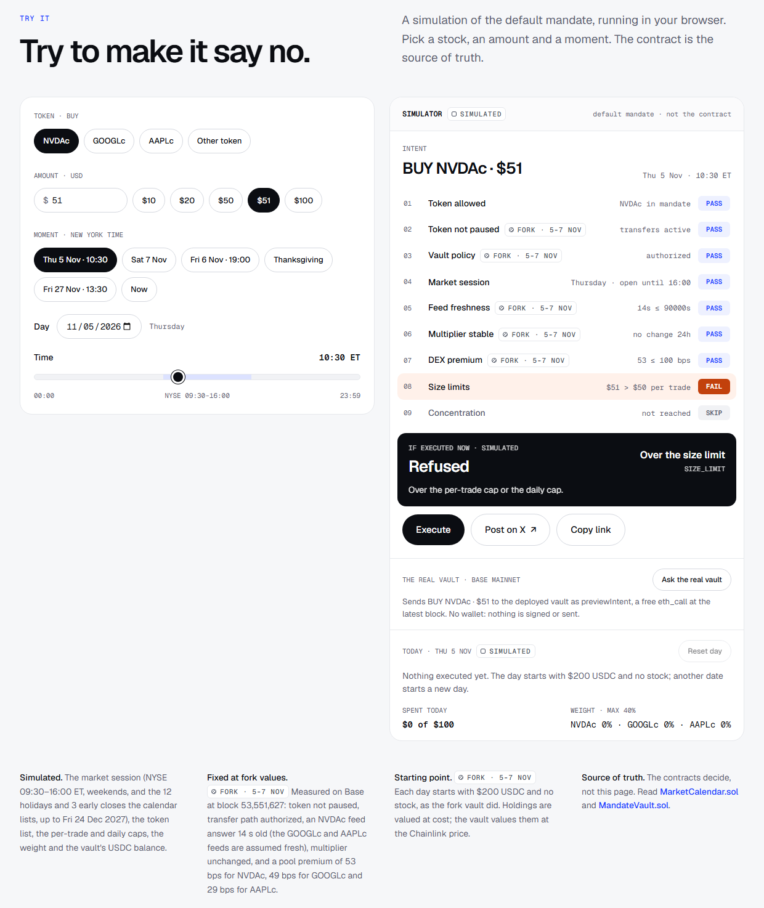
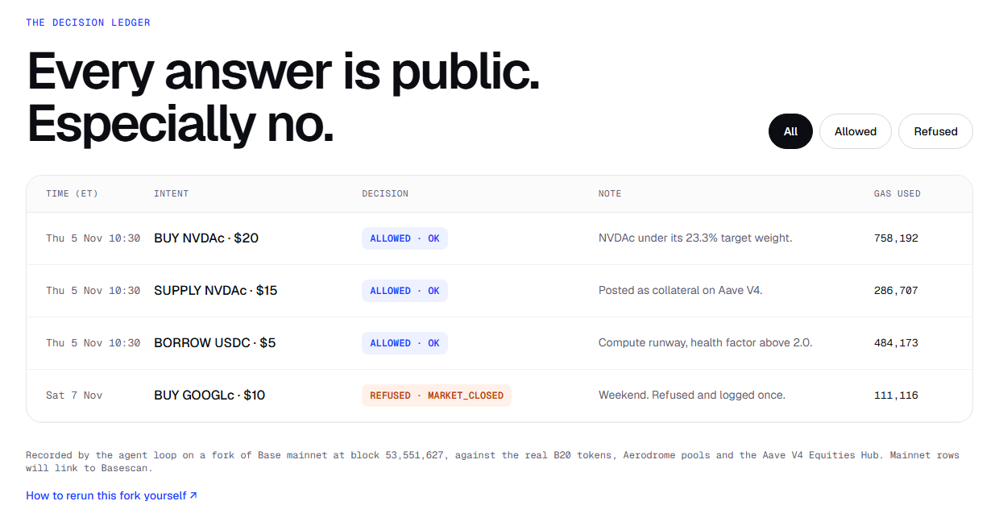
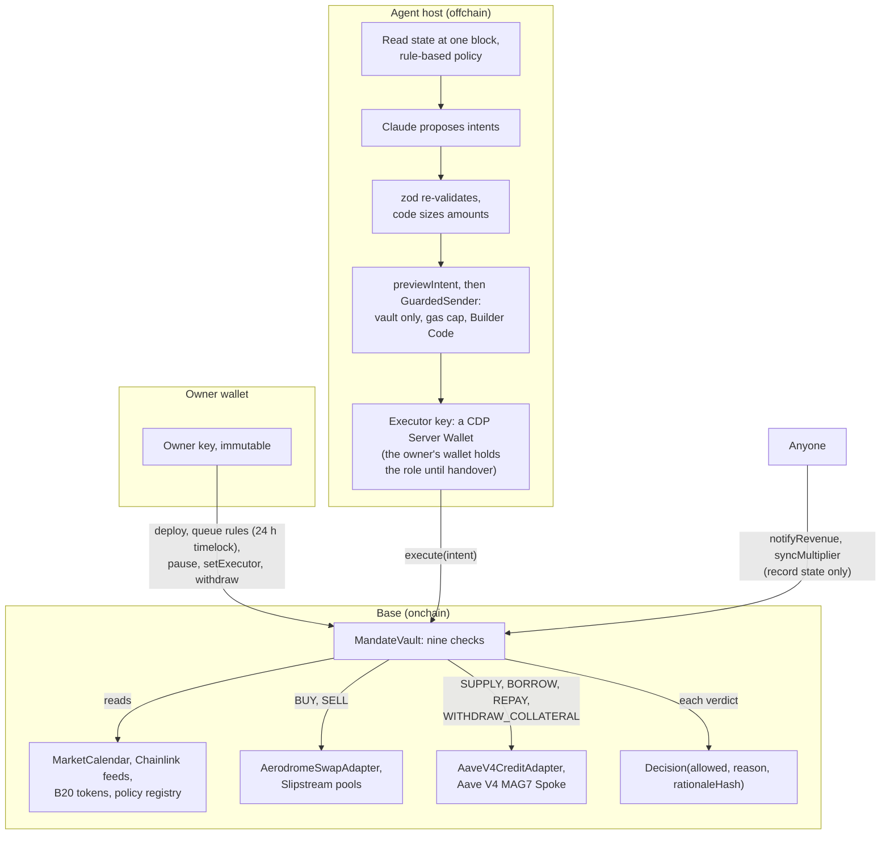

<div align="center">


# Maat

### The AI agent that knows when not to trade

**An AI treasury agent for tokenized stocks on Base. A model (Claude) proposes trades; the onchain `MandateVault` decides. It refuses when the US market is closed, the feed is stale, the pool has drifted from the oracle or a stock split is pending. A refusal does not revert: the vault emits a typed `Decision` event and moves no money.**

[](#status)
[](#base-mainnet-fork-evidence)
[](#by-track-agentic-stock-finance)
[](https://github.com/duongnq2798/maat/actions/workflows/ci.yml)
[](LICENSE)

**[For judges: 60 seconds](#maat-in-60-seconds)** · **[Live site](https://maatonbase.xyz)** · **[Try to make it say no](https://maatonbase.xyz/#try)** · **[Right now on Base](https://maatonbase.xyz/now)** · **[Weekend Gap Index](https://maatonbase.xyz/gap-index)** · **[Docs](https://maatonbase.xyz/docs)** · **[Evaluate in 5 minutes](#how-to-evaluate-maat-in-5-minutes)** · **[Tested, in numbers](#tested-in-numbers)** · **[Status](#status)** · **[Security](SECURITY.md)** · **[@maatonbase](https://x.com/maatonbase)**

<sub>Base "Stocks Maxxing Season" Builder Quest · Track: Agentic Stock Finance · Solidity 0.8.28 on Base (Foundry, <code>hardfork = "base:Cobalt"</code>) · TypeScript agent (viem 2.57.16, zod 4.6.7, <code>@anthropic-ai/sdk</code> 1.6.0, <code>@coinbase/cdp-sdk</code> 1.61.0) · Next.js 16.4.5 · B20 stocks · Chainlink equity feeds · Aerodrome Slipstream · Aave V4 · ERC-8021 Builder Codes</sub>

</div>

> The LLM proposes. The contract decides.

> [!IMPORTANT]
> **Status as of 2026-11-24.** The contracts are **unaudited**. The owner deployed the four Maat contracts to
> **Base mainnet** on 2026-11-24, by hand, from `main` at `66bd0d0`, with the default mandate; their
> addresses are in [`deployments/README.md`](deployments/README.md) ([Deployments and traction](#deployments-and-traction)).
> No Maat contract is on a testnet. The agent has run in live mode **only on a local fork of Base mainnet**, with
> a scripted proposer in place of Claude and a local test account as the sender. The real Claude API and the
> Coinbase CDP Server Wallet have been tested **only against fakes**. The website and its docs are **online** at [maatonbase.xyz](https://maatonbase.xyz).
> x402 revenue, the Guard Service API, MCP, the Bankr Skill and `MandateFactory` are **planned, not built** on
> `main` (an x402 Guard Service is in PR #2, open and unmerged). See [Status](#status).

## Maat in 60 seconds

- **What it is.** One AI agent, one onchain vault on Base. "Agent #1" is designed to trade only its own small
  treasury ($20 to $200) in USDC and three tokenized stocks (NVDAc, GOOGLc, AAPLc). Claude proposes;
  `MandateVault` runs nine checks on every buy and sell (concentration on a buy only), stops at the first
  failure and records each verdict as a `Decision` event, with 19 typed refusal codes.
- **Track and entry.** Agentic Stock Finance, in Base's "Stocks Maxxing Season" Builder Quest (2026-11-05 to
  2026-12-12). A new build: the first commit is `009577d`, 2026-11-06. [Track fit](#by-track-agentic-stock-finance).
- **Built on Base.** The checks read each B20 stock's pause flag, transfer policy, `uiMultiplier` and
  `effectiveAt` through the B20 precompile, Chainlink's equity feeds on Base and Aerodrome Slipstream TWAPs.
  Credit runs on the Aave V4 MAG7 Spoke. Agent transactions carry an ERC-8021 Builder Code, and the executor
  is built for a Coinbase CDP Server Wallet.
- **What is built and tested.** The vault, guard library, onchain NYSE calendar, Aerodrome and Aave V4
  adapters, deploy script, agent runtime, and the website with a 51-page docs center. CI on `main`
  ([run 44553264467](https://github.com/duongnq2798/maat/actions/runs/44553264467), 2026-11-19): 220 contract,
  167 agent, 1,494 website unit and 259 end-to-end tests passed.
- **On Base mainnet.** The owner deployed the four Maat contracts on 2026-11-24. They are unaudited.
  [Addresses](#deployments-and-traction).
- **What is not done yet.** No live run of the agent on mainnet, no run against the real Claude API or CDP,
  no audit; x402 and the rest are planned (see the box above).
- **Evidence.** On a local fork of Base mainnet at block 53,551,627 (Thursday 2026-11-05, 10:30 ET), the agent,
  with a scripted proposer, bought $20 of NVDAc (allowed, 758,192 gas). With the clock moved to Saturday, a $10
  GOOGLc buy was refused as market closed (`MARKET_CLOSED`) and logged on the fork (111,116 gas). [Fork evidence](#base-mainnet-fork-evidence).
- **Try it.** [Make the default mandate say no](https://maatonbase.xyz/#try) in a browser, or
  [evaluate in 5 minutes](#how-to-evaluate-maat-in-5-minutes) offline, with no keys.
- **Demo video.** Not published yet (as of 2026-11-19).

## Contents

- **Evidence:** [Check it with no clone](#check-it-with-no-clone) · [By track](#by-track-agentic-stock-finance) · [Tested, in numbers](#tested-in-numbers) · [Deployments and traction](#deployments-and-traction)
- **Design:** [The problem](#the-problem) · [How Maat works](#how-maat-works) · [What the model decides](#what-the-model-decides-and-what-code-enforces) · [The nine checks](#the-nine-checks) · [Status](#status) · [Safety architecture](#safety-architecture)
- **Base:** [Base mainnet fork evidence](#base-mainnet-fork-evidence) · [Base integrations](#base-integrations) · [Why not a spending cap?](#why-not-a-spending-cap-or-an-offchain-market-hours-check)
- **Run it:** [Evaluate in 5 minutes](#how-to-evaluate-maat-in-5-minutes) · [Development](#development) · [Known limitations](#known-limitations) · [Roadmap](#roadmap)
- **About:** [Built during the Quest](#built-during-the-quest) · [Compliance](#compliance) · [Where things are](#where-things-are-in-this-repository) · [Documentation](#documentation) · [Contact and security](#contact-and-security) · [License](#license)

## Check it with no clone

1. **Make it say no.** [maatonbase.xyz/#try](https://maatonbase.xyz/#try) simulates the default mandate's BUY
   checks in your browser. Pause, policy, feed age, multiplier and premium are fixed at fork values; the
   contract, not the page, is the source of truth.
2. **See Base right now.** [maatonbase.xyz/now](https://maatonbase.xyz/now) reads the 13 B20s with a NAV from Base
   mainnet in your browser, at a block it links on Basescan, and judges a BUY of each with the vault's checks, in
   its order. Checks 3, 8 and 9 need a vault's address or balances, and `/now` reads no vault, so they are not run.
3. **Read the fork ledger.** [maatonbase.xyz/#ledger](https://maatonbase.xyz/#ledger) shows the four decisions
   of the agent's run on a Base mainnet fork, labelled as a fork.
4. **Open the CI run.** [Run 44553264467](https://github.com/duongnq2798/maat/actions/runs/44553264467) on
   `main`; [Tested, in numbers](#tested-in-numbers) links the job log behind each CI figure.
5. **See what is built.** [Status and roadmap](https://maatonbase.xyz/docs/get-started/status).
6. **Read the checks.** [The nine checks](https://maatonbase.xyz/docs/concepts/nine-checks).
7. **Read it as plain text.** [`/llms.txt`](https://maatonbase.xyz/llms.txt) indexes the docs for AI readers;
   [`/llms-full.txt`](https://maatonbase.xyz/llms-full.txt) holds all of them.

<p align="center">
  <a href="docs/assets/readme/simulator-size-limit.png"></a>
  <a href="docs/assets/readme/fork-ledger.png"></a>
</p>

Left: the simulator refusing a $51 buy as over the size limit (`SIZE_LIMIT`). Right: the fork ledger.

## By track: Agentic Stock Finance

The quest page describes the track as "Build agents that research, earn or trade around tokenized stocks in
novel ways." It lists four ideas. Where Maat stands on each, as of 2026-11-19:

| Idea (quest page) | What Maat does | Status | Where |
| --- | --- | --- | --- |
| Agents that earn a stock treasury | Holds its own USDC and stocks. USDC that arrives is recorded as `RevenueReceived`, and new revenue repays debt. The planned income, x402 fees for safety checks, is not on `main` | **Partly**: x402 is in PR #2, unmerged | [`notifyRevenue`](contracts/src/MandateVault.sol#L124-L131), [`policy.ts`](agent/src/policy.ts#L72-L79) |
| Research-to-portfolio agents | Claude reads the vault's state, the policy's weights and its arithmetic suggestions, then proposes portfolio changes. There is no research step: the prompt forbids price prediction and news chasing | **Partly**: portfolio only, no research | [`prompt.ts`](agent/src/llm/prompt.ts#L28-L32) |
| Stock-backed credit for agents | Supplies stocks to the Aave V4 MAG7 Spoke, borrows USDC against them, repays and withdraws. A borrow needs an open market and a health factor of 1.5, or 2.0 in the de-risk window | **Built and fork-tested** | [`AaveV4CreditAdapter.sol`](contracts/src/adapters/AaveV4CreditAdapter.sol), [`MandateVaultCreditFork.t.sol`](contracts/test/fork/MandateVaultCreditFork.t.sol) |
| Agent-managed rebalancing | Equal weights after a 30% USDC reserve (23.3% per stock), rebalanced past a 5-point drift. The vault refuses a buy that takes one stock above 40% | **Built**, unit-tested; the fork run's trades came from a scripted proposer | [`policy.ts`](agent/src/policy.ts#L14), [`test_concentration`](contracts/test/MandateVault.t.sol#L106) |

Bankr is a partner of this track. Nothing is built for it yet; a Bankr Skill is planned.

## Tested, in numbers

| What | Figure | Read at | Source |
| --- | --- | --- | --- |
| Contract unit tests | 220 passed, 0 failed, 0 skipped (8 suites) | CI, `main` `3778fea`, 2026-11-19 | [contracts job](https://github.com/duongnq2798/maat/actions/runs/44553264467/job/135662370563) |
| Agent unit tests | 167 passed (24 files) | CI, `3778fea`, 2026-11-19 | [agent job](https://github.com/duongnq2798/maat/actions/runs/44553264467/job/135662370733) |
| Website unit, component and parity tests | 1,494 passed (42 files) | CI, `3778fea`, 2026-11-19 | [web job](https://github.com/duongnq2798/maat/actions/runs/44553264467/job/135662370486) |
| Website end-to-end tests (Playwright) | 259 passed, 0 failed, 0 skipped, 0 flaky | CI, `3778fea`, 2026-11-19 | [web job](https://github.com/duongnq2798/maat/actions/runs/44553264467/job/135662370486) |
| Pages checked in the built site | the landing page and 49 docs pages | CI, `3778fea`, 2026-11-19 | [web job](https://github.com/duongnq2798/maat/actions/runs/44553264467/job/135662370486) |
| Secret scan, full history | 0 findings over 426 commits (every ref in the CI checkout) | CI, `3778fea`, 2026-11-19 | [secret scan job](https://github.com/duongnq2798/maat/actions/runs/44553264467/job/135662369784) |
| Secret scan, every commit message | 0 findings | CI, `3778fea`, 2026-11-19 | [secret scan job](https://github.com/duongnq2798/maat/actions/runs/44553264467/job/135662369784) |
| Tests of the CI's own scripts | 67 passed | CI, `3778fea`, 2026-11-19 | [summary job](https://github.com/duongnq2798/maat/actions/runs/44553264467/job/135670265212) |
| `MandateVault` runtime size | 22,755 bytes, 1,821 under the 24,576-byte limit | CI, `3778fea`, 2026-11-19 | [contracts job](https://github.com/duongnq2798/maat/actions/runs/44553264467/job/135662370563) |
| Contract fork tests | 14 passed (7 files), run by hand | recorded at `4492eed`, 2026-11-07 | [`contracts/test/fork/`](contracts/test/fork) |
| Agent fork integration tests | 3 passed, run by hand | recorded at `4492eed`, 2026-11-07 | [`agent.fork.test.ts`](agent/test/integration/agent.fork.test.ts) |
| Gas used in the agent fork run | BUY 758,192 · SUPPLY 286,707 · BORROW 484,173 · refusal log 111,116 | run by hand, 2026-11-07 | [`fork-gas.json`](agent/test/integration/fork-gas.json) |

The CI figures are from push run 44553264467 on `3778fea`, the run read for this README. CI runs only the
offline suites. The two fork suites need a Base archive RPC, so they run by hand and are as fresh as the last
hand run. Between `4492eed` and `3778fea`, no file in `contracts/src`, `contracts/script` or `agent/src`
changed (`git diff --stat 4492eed 3778fea` over those folders is empty), and one fork test file had a 2-line
change. Since `3778fea`, `contracts/src/MarketCalendar.sol` preloads the 2027 NYSE holidays and the 2027-11-26
early close, `contracts/script/MaatConfig.sol` sets the 25 h staleness and 150 bps slippage defaults, and the
agent fork test's `deploy.ts` uses those two values. `contracts/script/Deploy.s.sol` can also allowlist an
optional second expense payee, and the fork test `DeployFork.t.sol` pins it to unset. The fork figures
above were recorded at `4492eed`, before these changes; the agent fork run's vault had a 3600 s staleness and
a 100 bps slippage limit. No figure here is rounded.

## Deployments and traction

| Contract | Base mainnet |
| --- | --- |
| `MarketCalendar` | Deployed; [address and deploy tx](deployments/README.md) |
| `AerodromeSwapAdapter` | Deployed; [address and deploy tx](deployments/README.md) |
| `AaveV4CreditAdapter` | Deployed; [address and deploy tx](deployments/README.md) |
| `MandateVault` | Deployed; [address and deploy tx](deployments/README.md) |

The owner deployed the four Maat contracts on 2026-11-24, from `main` at `66bd0d0`, with the
default mandate in [`contracts/script/MaatConfig.sol`](contracts/script/MaatConfig.sol). The contracts are
unaudited. On 2026-11-24, Basescan showed the source of all four as verified, with an exact match. The table
in [`deployments/README.md`](deployments/README.md) records each address and deploy transaction, with Basescan
links; the docs show the same table on
[Status and roadmap](https://maatonbase.xyz/docs/get-started/status#next-mainnet) and
[Base addresses](https://maatonbase.xyz/docs/reference/base-addresses).

- **Builder Code.** The ERC-8021 suffix is built and tested. The owner registered Maat's code on the Base
  Dashboard, and the calldata of the vault's first `Decision` on Base mainnet
  ([`0xdfdb6739...6c3b`](https://basescan.org/tx/0xdfdb6739912a73542d90129bd7269a939dc8b2d47a869f56d9ab5e3a02e86c3b)) carries it.
- **Executor.** Not yet handed to the CDP Server Wallet; the runbook starts with the owner's own wallet.
- **Owner smoke test.** On 2026-11-24 the owner, as the executor, sent two 5 USDC NVDAc `BUY` intents with
  [`deployments/go-live.md`](deployments/go-live.md) and the calldata of
  [`agent/scripts/first-decision.ts`](agent/scripts/first-decision.ts); the agent runtime sent neither. The vault
  refused the first, before the US market opened, with `MARKET_CLOSED`
  ([`0xdfdb6739...6c3b`](https://basescan.org/tx/0xdfdb6739912a73542d90129bd7269a939dc8b2d47a869f56d9ab5e3a02e86c3b)),
  and allowed the second, in session, with reason `OK`
  ([`0x61622340...23c8`](https://basescan.org/tx/0x61622340a151c73c3f2b3bc910292a3e3136bd4aa7ecd55a92f59914953a23c8),
  block 61,745,836, 16:59:02 UTC), which swapped 5 USDC for 0.03311718 NVDAc.
- **Mainnet `Decision` events.** This README keeps no count. Every `Decision` the vault emits is public in its
  events on Basescan, at the `MandateVault` address in [`deployments/README.md`](deployments/README.md). The
  [mainnet ledger](https://maatonbase.xyz/ledger) reads them from Base in your browser, with the vault's
  treasury and mandate. [Watch decisions onchain](https://maatonbase.xyz/docs/guides/watch-decisions-onchain)
  shows how to read and decode the events yourself.
- **How a deploy happens.** Only the owner deploys, from their own wallet, following the go-live runbook
  [`deployments/go-live.md`](deployments/go-live.md): deploy, fund, the first `Decision` events (a weekend BUY
  the vault must refuse, then one in session it must allow) and the executor handover, in order.
  [`deployments/README.md`](deployments/README.md) keeps the reference it draws on (the checklist, commands,
  smoke tests, unwind procedure and executor switch) and the address table.

## The problem

Tokenized stocks on Base trade 24 hours a day, 7 days a week. The stocks they track do not. Each hazard below
is something the vault checks for, with the reason code it returns.

| Hazard | What goes wrong for an agent that trades 24/7 | Reason code |
| --- | --- | --- |
| **The market is closed** | NYSE trades 09:30 to 16:00 ET on weekdays. The Chainlink equity feeds on Base are assumed to update only from Sunday 20:00 ET to Friday 20:00 ET. On a Saturday or a holiday the DEX price has no live reference | `MARKET_CLOSED` |
| **The oracle is stale or broken** | A feed that stopped updating, or returns zero or a negative answer, cannot value anything | `FEED_STALE`, `BAD_PRICE` |
| **The pool has drifted from the oracle** | A thin CL pool can trade far from the feed. The vault compares a 30-minute TWAP with the oracle; in session on 2026-11-05 the gap measured 29 to 53 bps for the three basket stocks | `PREMIUM_TOO_HIGH` |
| **A corporate action is under way** | A split or dividend changes the B20 `uiMultiplier`. Values computed across the change are wrong, so the vault waits out a cooldown after any change, and refuses while a change is scheduled | `MULTIPLIER_COOLDOWN` |
| **The issuer paused the token, or its transfer policy blocks the path** | B20 tokens can pause transfers and enforce sender, receiver and executor policies. A swap that would fail mid-way should be refused up front | `TOKEN_PAUSED`, `POLICY_BLOCKED` |
| **The agent is simply wrong** | It proposes too much, too often, or all in one stock | `SIZE_LIMIT`, `CONCENTRATION` |

Spending caps on an agent wallet stop the last row. They do not know whether NYSE is open, whether the feed
is alive or whether a split is pending. Maat checks all of these onchain, before any buy or sell.

## How Maat works



One round, every 15 minutes in session and every hour outside ([`scheduler.ts`](agent/src/loop/scheduler.ts#L5-L6)):

1. **Read.** Read the vault, tokens, feeds and Aave position at one pinned block; if a required read fails, do
   nothing. Reconcile any pending send, and send `syncMultiplier` for a stock whose multiplier changed.
2. **Suggest.** A rule-based policy keeps an equal-weight basket of NVDAc, GOOGLc and AAPLc with 30% in USDC
   and rebalances past a 5-point drift. With `MAAT_CREDIT_ACTIONS=on` (off by default) it also supplies idle
   stock to Aave V4, borrows USDC when cash falls below seven days of compute cost, and repays debt when revenue
   arrives (the planned source, x402 fees, is not built).
3. **Propose.** Claude gets the state and the suggestions, and may adopt, resize or drop them. Proposing
   nothing is a valid answer.
4. **Check before sending.** Code re-validates the answer, clamps each amount except a borrow, previews it as
   the executor, and sends it only if it is allowed, or if it is a safety refusal not yet logged for its
   NYSE date (and, for `MARKET_CLOSED`, its closed phase). With credit actions off, a credit proposal is
   dropped before the preview. The compute bill goes first if at least $1.00 is owed in live mode ($0.10 in
   dry-run, or `MAAT_BILL_MIN_USD`): `PAY_EXPENSE` to an allowlisted payee, the
   wallet that pays for its Claude usage (for Agent #1, the owner's). Claude's schema cannot express
   `PAY_EXPENSE`; code adds it.
5. **Decide.** The vault runs its checks and emits a `Decision` either way. A borrow needs an open market and a
   projected health factor of at least 1.5; the health-factor floor rises in the hours before the feeds stop
   for a weekend or holiday, to 2.0 inside that de-risk window.
6. **Journal.** Everything goes to `data/journal.jsonl`, with each rationale next to its `rationaleHash`.

`MAAT_MODE` defaults to `dry-run`: it reads the chain and calls Claude but sends nothing. Live mode through
`npm run agent` needs a registered Builder Code and CDP keys, set up by the owner
([`agent/README.md`](agent/README.md)). Live mode refuses a data directory whose journal holds dry-run rows, so
a dry run and the live agent each get their own `MAAT_DATA_DIR`. `npm run agent:loop` restarts the agent each
time it exits and warns when no round has ended for 90 minutes or the agent keeps exiting. The fork integration test runs live mode with a test code
(`bc_maattest`) and a local sender instead.

The owner can pause the vault, swap the executor key and withdraw at any time, and can change the rules only
through a 24-hour timelock. The default mandate ([`MaatConfig.defaultMandate`](contracts/script/MaatConfig.sol))
allows $50 per trade and $100 per UTC day, and no stock above 40% of net equity after a buy
([every value](https://maatonbase.xyz/docs/reference/default-parameters)).

Its feed-staleness limit, `maxStaleness`, is 90000 s (25 hours: the feeds' 24 h heartbeat plus 1 h), and its
slippage limit, `maxSlippageBps`, is 150 (a swap must return at least 98.5% of the oracle-implied amount). Both
come from Base mainnet, read-only, over the 10 NYSE sessions of Nov 2-6 and Nov 9-13, 2026. The B20 equity feeds
update on a 0.5% price move or a 24 h heartbeat: in session they were older than one hour for 45.9% of the time
on AAPL, 37.6% on GOOGL and 9.8% on NVDA, and never older than 24 h. The worst BUY cost against the oracle (pool
spot price plus fee, every 15 minutes) was 121 bps on NVDAc, p99 109 bps, so 150 bps costs at most $0.75 on a
$50 trade. Simulated $50 BUYs passed 81% / 60% / 53% of the time (NVDAc / GOOGLc / AAPLc) with the old limits
(3600 s staleness, 100 bps slippage) and 93% / 98% / 99% with these. Most NVDAc refusals left are
`PREMIUM_TOO_HIGH` in the first 45 minutes after the open, while the 30-minute TWAP still reflects the overnight
price. A dead feed is still caught. For `BUY` and `SELL` the premium check is the guard against a frozen price;
`BORROW` and `WITHDRAW_COLLATERAL` against debt have no premium check and rely on the 25 h limit alone. The
measurement script and its data are not in the repository, so these figures cannot be re-run from it.

## What the model decides, and what code enforces

| Step | Who decides | Bound | Where |
| --- | --- | --- | --- |
| Suggest | Code: a rule-based policy | Equal weights after a 30% USDC reserve, a 5-point drift trigger. Advisory only | [`policy.ts#L13`](agent/src/policy.ts#L13) |
| Propose | The model, `claude-sonnet-5-5` by default | At most 6 intents (`MAX_INTENTS`), each a listed action and symbol, a positive dollar amount and a rationale of 1 to 600 characters (`MAX_RATIONALE_CHARS`). No `PAY_EXPENSE` | [`schema.ts#L3-L22`](agent/src/llm/schema.ts#L3-L22), [`config.ts#L27`](agent/src/config.ts#L27) |
| Re-validate | Code: zod `BatchSchema` | An answer that breaks one bound is rejected whole | [`proposer.ts#L145-L146`](agent/src/llm/proposer.ts#L145-L146) |
| Size | Code: `buildIntent` | Each amount except a borrow is clamped to the balance, the debt or the supplied collateral; a borrow is bounded by the vault's health-factor check | [`intent.ts#L72-L95`](agent/src/intent.ts#L72-L95) |
| Preview | The vault, through `previewIntent` (an `eth_call` as the executor) | The verdict `execute` reaches before acting. It cannot predict `SWAP_FAILED`, `TRANSFER_FAILED`, a `CREDIT_FAILED` from the credit call itself, or the credit adapter's own health check | [`MandateVault.sol#L115-L120`](contracts/src/MandateVault.sol#L115-L120), [`preview.ts#L14`](agent/src/chain/preview.ts#L14) |
| Send or skip | Code: the send gate | Send if `OK`; never if the preview is unknown; log a safety refusal at most once per reason per NYSE date, and `MARKET_CLOSED` once per closed phase of that date. With `MAAT_CREDIT_ACTIONS` off (the default), a credit proposal is dropped before the preview | [`refusals.ts#L5-L29`](agent/src/refusals.ts#L5-L29), [`runOnce.ts#L304-L310`](agent/src/loop/runOnce.ts#L304-L310) |
| Send | Code: `GuardedSender` | Vault address only; `execute`, `syncMultiplier` or `notifyRevenue` only; gas limit at most 3,000,000; every `execute` carries the maat:v1 blob its `rationaleHash` commits to; Builder Code appended | [`sender.ts#L30-L85`](agent/src/exec/sender.ts#L30-L85) |
| Decide | The vault | The nine checks; the first failure is the reason; a refusal does not revert | [`MandateVault.sol#L257-L282`](contracts/src/MandateVault.sol#L257-L282) |
| Record | The vault | `Decision` carries `rationaleHash`, the `keccak256` of the rationale blob that follows the call in the same transaction; the agent's journal keeps the text and the blob | [`MandateVault.sol#L112`](contracts/src/MandateVault.sol#L112), [`intent.ts#L48-L50`](agent/src/intent.ts#L48-L50), [`runOnce.ts#L340-L342`](agent/src/loop/runOnce.ts#L340-L342) |

The model chooses what to try and says why; code bounds its answer; only the vault decides.

## The nine checks

`BUY` and `SELL` go through these checks in this order. The first failure decides the reason.
Code: [`MandateVault._check`](contracts/src/MandateVault.sol#L257-L282) and
[`GuardLib.checkMarket`](contracts/src/GuardLib.sol#L44-L62).

| # | Check | Refusal | Where | A test that shows it |
| --- | --- | --- | --- | --- |
| – | Vault not paused (every action except `REPAY`) | `VAULT_PAUSED` | [`MandateVault.sol#L259`](contracts/src/MandateVault.sol#L259) | `test_vaultPaused` |
| 1 | Token is in the mandate. `BUY` needs an allowed token; `SELL` also works for exit-only tokens, so a delisted stock can still be sold | `TOKEN_NOT_ALLOWED` | [`MandateVault.sol#L266`](contracts/src/MandateVault.sol#L266) | `test_exitOnlyTokenCanBeSoldNotBought` |
| 2 | Token transfers are not paused; a reverting read counts as paused | `TOKEN_PAUSED` | [`GuardLib.tokenPaused`](contracts/src/GuardLib.sol#L65) | `test_refusesPausedToken` |
| 3 | Every leg of the transfer passes the B20 policy registry (sender, receiver, executor, including `tx.origin`) | `POLICY_BLOCKED` | [`GuardLib.transferPathAuthorized`](contracts/src/GuardLib.sol#L145) | `test_refusesWhenPolicyBlocksVault` |
| 4 | Market open for the mandate's session (`REGULAR`: NYSE 09:30 to 16:00 ET with holidays and early closes) | `MARKET_CLOSED` | [`GuardLib.marketOpen`](contracts/src/GuardLib.sol#L74), [`MarketCalendar.isOpen`](contracts/src/MarketCalendar.sol#L74) | `test_refusalIsLoggedNotReverted`, `test_thanksgivingIsMarketClosedAtVaultLevel` |
| 5 | Oracle answer is positive and not older than `maxStaleness` | `FEED_STALE`, `BAD_PRICE` | [`PriceLib.readFeed`](contracts/src/lib/PriceLib.sol), [`GuardLib.sol#L50-L52`](contracts/src/GuardLib.sol#L50-L52) | `test_refusesStaleFeed` |
| 6 | No multiplier change: unchanged since the last snapshot, outside the cooldown, nothing scheduled | `MULTIPLIER_COOLDOWN` | [`GuardLib.multiplierBlocked`](contracts/src/GuardLib.sol#L118) | `test_multiplierChangeStartsCooldown`, `test_pendingMultiplierBlocks` |
| 7 | Pool TWAP is within `maxPremiumBps` of the oracle | `PREMIUM_TOO_HIGH`, `BAD_PRICE` | [`PriceLib.premiumBps`](contracts/src/lib/PriceLib.sol), [`GuardLib.sol#L58-L60`](contracts/src/GuardLib.sol#L58-L60) | `test_refusesPremium` |
| – | Amount is non-zero and covered by the balance. Market reasons take precedence | `INSUFFICIENT_BALANCE` | [`MandateVault.sol#L271-L274`](contracts/src/MandateVault.sol#L271-L274) | `test_marketReasonTakesPrecedenceOverBalance` |
| 8 | Notional within the per-trade cap and the UTC-day cap | `SIZE_LIMIT` | [`MandateVault._withinCaps`](contracts/src/MandateVault.sol#L500) | `test_perTradeCap`, `test_dailyCap` |
| 9 | `BUY` only: the stock's weight after the buy stays within `maxWeightBps`, measured on equity net of Aave debt; unreadable positions fail closed | `CONCENTRATION` | [`MandateVault._weightAfterBuyBps`](contracts/src/MandateVault.sol#L512) | `test_concentration`, `test_concentrationNetsCreditDebt` |

After the checks pass, the vault swaps with a slippage floor it computes from the oracle price and
`maxSlippageBps`, whatever `minOut` the agent sent (the agent always sends 0:
`test_slippageFloorIsEnforcedEvenIfAgentSendsZero`). A failed swap or transfer is recorded as `SWAP_FAILED` or
`TRANSFER_FAILED`, and `execute` still does not revert.

**Other actions** ([`_checkExpense`](contracts/src/MandateVault.sol#L284),
[`_checkCredit`](contracts/src/MandateVault.sol#L295)). `PAY_EXPENSE` checks the payee allowlist, the balance,
the per-trade cap and the shared daily cap, and works when the market is closed. `SUPPLY` checks the token, pause and policy path. `BORROW` needs an open
market, healthy collateral (checks 2, 5 and 6 on every supplied stock) and the health-factor floor
(`HEALTH_FACTOR_LOW`, `DERISK_WINDOW`). `REPAY` works at any hour, even while paused.

**Refusal codes.** `enum Reason` in [`Types.sol`](contracts/src/Types.sol) is append-only: `OK` is 0, then 19
typed refusals, each explained in [Refusal codes](https://maatonbase.xyz/docs/concepts/refusal-codes). The
agent's copy is tested against it ([`agent/test/types.test.ts`](agent/test/types.test.ts)), and so is the website's.

## Status

**Online**: served in public (the website only). **Built and tested**: on `main`, with passing tests.
**Built**: on `main`, tested only as noted. **Planned**: not on `main`. **Deployed**: on Base mainnet, at the
address in [`deployments/README.md`](deployments/README.md).
The test counts in the table are from CI run [44553264467](https://github.com/duongnq2798/maat/actions/runs/44553264467)
on `main` (`3778fea`, 2026-11-19), and the fork counts from the hand run at `4492eed`, 2026-11-07, as in
[Tested, in numbers](#tested-in-numbers). Later commits add tests, so a suite run on this tree can report more.

| Component | Status | Where |
| --- | --- | --- |
| `MandateVault`: holds USDC and B20 stocks, runs the nine checks, logs each verdict as `Decision`, 24 h timelock on every rule change | **Built and tested** (220 unit tests across the contracts, 14 fork tests). **Deployed** on Base mainnet | [`contracts/src/MandateVault.sol`](contracts/src/MandateVault.sol) |
| `GuardLib`: market-safety checks (pause, transfer policy, session, feed, multiplier, premium) | **Built and tested** | [`contracts/src/GuardLib.sol`](contracts/src/GuardLib.sol) |
| `MarketCalendar`: NYSE session in America/New_York, DST computed onchain, holidays and early closes | **Built and tested**. Preloaded with 12 holidays and 3 early closes up to 2027-12-24 (the NYSE calendar for 2027). **Deployed** on Base mainnet | [`contracts/src/MarketCalendar.sol`](contracts/src/MarketCalendar.sol) |
| `AerodromeSwapAdapter`: exact-input swaps directly against Aerodrome Slipstream pools | **Built**, unit and fork tested. **Deployed** on Base mainnet | [`contracts/src/adapters/AerodromeSwapAdapter.sol`](contracts/src/adapters/AerodromeSwapAdapter.sol) |
| `AaveV4CreditAdapter`: supply B20 collateral, borrow and repay USDC on the Aave V4 MAG7 Spoke | **Built**, unit and fork tested (full supply, borrow, repay, withdraw loop). **Deployed** on Base mainnet | [`contracts/src/adapters/AaveV4CreditAdapter.sol`](contracts/src/adapters/AaveV4CreditAdapter.sol) |
| Deploy script and Base mainnet configuration | **Built**; simulated on a fork (`test_deployWiresEverything`). The dry-run command against live mainnet state is in [`deployments/README.md`](deployments/README.md). The owner deployed the four Maat contracts to Base mainnet on 2026-11-24, from `main` at `66bd0d0` | [`contracts/script`](contracts/script) |
| Agent runtime: vault reader, rule-based policy, Claude proposer, preview, guarded sender, journal, pending-tx reconcile | **Built and tested** (167 unit tests, 3 fork integration tests). The Claude proposer is tested against a fake client and the fork run uses a scripted proposer; no output from the real Claude API is committed yet | [`agent/`](agent) |
| ERC-8021 Builder Code on every agent transaction | **Built and tested** (unit tests and the fork run). Registered by the owner; the calldata of the vault's first `Decision` on Base mainnet carries it | [`agent/src/exec/builderCode.ts`](agent/src/exec/builderCode.ts) |
| Coinbase CDP Server Wallet as the executor, with an account policy | **Built**, tested against a fake CDP client only. Never run against real CDP | [`agent/src/exec/cdpSender.ts`](agent/src/exec/cdpSender.ts), [`agent/src/exec/cdpPolicy.ts`](agent/src/exec/cdpPolicy.ts) |
| Website: landing page with the decision engine, the simulator and the labelled fork ledger, the [mainnet ledger](https://maatonbase.xyz/ledger), which reads the deployed vault from Base in the visitor's browser, and the docs center. The landing's first screen leads with the vault's latest `Decision`, which the browser reads with the mainnet ledger's loader, and keeps the fork run as a tab labelled Fork replay. The live strip under the landing H1 and `/now` read Base mainnet in the browser. The Weekend Gap Index (`/gap-index`) is built from edition files measured from Base logs and committed in `web/content/gap-index/` | **Online** at [maatonbase.xyz](https://maatonbase.xyz), a static export of `main`. **Built and tested** (1,494 unit tests and 259 Playwright tests passed in CI run [44553264467](https://github.com/duongnq2798/maat/actions/runs/44553264467) at `3778fea`, before the mainnet ledger, the live strip, `/now` and `/gap-index` were added; step 5 of the [5-minute guide](#how-to-evaluate-maat-in-5-minutes) shows this tree's unit-test count) | [`web/`](web) |
| A rationale store the agent writes as it runs, read by the mainnet ledger (W2 follow-up); daily diary and replay page (W3) | **Planned** | [W2 spec §10](docs/superpowers/specs/2026-11-20-maat-web-w2-ledger-design.md), [web spec §10](docs/superpowers/specs/2026-11-07-maat-web-design.md) |
| x402 revenue: other agents pay about one cent per "is this trade safe now?" check | **Planned**. Not on `main`; PR #2, open and unmerged, adds an x402 Guard Service | [spec §3.4](docs/superpowers/specs/2026-11-06-mandate-treasury-design.md) |
| Guard Service HTTP API, MCP server, Bankr Skill | **Planned** (the Guard Service is part of the unmerged PR #2) | [spec §3.4](docs/superpowers/specs/2026-11-06-mandate-treasury-design.md) |
| `MandateFactory`: any agent deploys its own vault | **Planned** (stretch goal) | [spec §3.7](docs/superpowers/specs/2026-11-06-mandate-treasury-design.md) |
| Third-party audit | **None**. Treat the contracts as unaudited | |

## Safety architecture

**If the executor key leaks.** Say an attacker controls the server that runs the agent:

| The attacker can | but cannot |
| --- | --- |
| Call `execute` with any intent | Skip any of the nine checks, trade outside the session or the stock list, or beat the $50 per-trade and $100 per-day caps |
| Make bad but allowed trades inside the mandate | Send funds anywhere: swaps go to the allowlisted pool, borrowed USDC and collateral come back to the vault, and `PAY_EXPENSE` pays only allowlisted payees |
| Borrow against the stocks | Push the projected health factor below 1.5 (2.0 in the de-risk window) |
| Stop the agent | Change the mandate, withdraw, unpause or keep the key: the owner pauses or rotates the executor instantly, from their own wallet |

The fork test `test_compromisedExecutorIsBounded`
([`MandateVaultFork.t.sol`](contracts/test/fork/MandateVaultFork.t.sol#L83)) tries this against real Base
state: the executor pays $100 to an attacker address (`PAYEE_NOT_ALLOWED`), buys $60 of NVDAc (`SIZE_LIMIT`)
and calls `withdraw` (reverts `NotOwner`); the vault keeps all 200 USDC. Gaps: [Known limitations](#known-limitations).

| Layer | What it enforces | Where |
| --- | --- | --- |
| **The executor's only power is `execute`** | Apart from `execute`, every function that moves funds or changes a rule is owner-only, and the owner is immutable. `notifyRevenue` and `syncMultiplier` are open to anyone and only record state | [`MandateVault.sol`](contracts/src/MandateVault.sol), `test_executorCannotUseOwnerFunctions` |
| **Refuse, do not revert** | A refused intent emits `Decision` and moves nothing. By design only `NotExecutor` and `IntentAlreadyUsed` revert. A dependency can still make `execute` revert in a few ways the vault does not catch: return data that does not fit the ABI, a revert in a read that no `try` guards (such as an ERC-20 `balanceOf` or `decimals`, or the pool's `token0()` after a TWAP `observe` returns, outside its `catch`), and a pool answer the TWAP's tick math cannot use | `test_refusalIsLoggedNotReverted`, [`MandateVaultMalformed.t.sol`](contracts/test/MandateVaultMalformed.t.sol) |
| **Fail closed** | A reverting pause, policy, calendar, multiplier, feed or Aave read counts as unsafe. The feed case is in [`PriceLib.readFeed`](contracts/src/lib/PriceLib.sol#L13-L20), and no contract test makes the feed's `latestRoundData` revert | `test_reverting*FailsClosed` in [`GuardLib.t.sol`](contracts/test/GuardLib.t.sol), `test_unreadableCollateralFailsConcentrationClosed` |
| **24-hour timelock** | Mandate, token and payee changes are queued, then applied with the exact queued values from 24 hours after queueing until 7 days after that, or cancelled | `test_mandateChangeNeedsTimelock`, `test_appliedParamsMustMatchQueued`, `test_expiredChangeReverts` |
| **Owner escape hatches** | `setPaused` (instant; `REPAY` still works), `setExecutor` (instant key rotation), `withdraw` (only to the owner) | `test_repayIsAllowedWhileVaultPaused`, `test_rotatingExecutorRevokesOldOne`, `test_withdrawOnlyGoesToOwner` |
| **Guarded sender** | The agent sends only `execute`, `syncMultiplier` or `notifyRevenue` to the vault address, with an explicit gas limit (at most 3,000,000) and the Builder Code suffix | [`agent/src/exec/sender.ts`](agent/src/exec/sender.ts), [`sender.test.ts`](agent/test/sender.test.ts) |
| **Exactly-once sends** | Every `execute` is stored as pending before it is sent; the next round settles it before doing anything else, from the tx receipt once the tx is mined, otherwise against `usedIntent`, so a send that threw after broadcast is not sent again. Not covered: a pending send dropped after the window; its bill is sent again, and if the first send lands late, the bill is paid twice ([Security model](https://maatonbase.xyz/docs/security/model)) | [`agent/src/loop/runOnce.ts`](agent/src/loop/runOnce.ts), `runOnce.test.ts` "reconciles a send that threw after broadcast instead of sending again" |

<details>
<summary>Eight more layers</summary>

| Layer | What it enforces | Where |
| --- | --- | --- |
| **Nine checks, in the contract** | Market safety and size on every `BUY` and `SELL`, concentration on every `BUY`; health factor on every borrow | [The nine checks](#the-nine-checks) |
| **Single-use intents** | Each intent id executes once, refused or not | `test_replayReverts` |
| **Slippage floor from the oracle** | The vault, not the agent, sets the minimum output | `test_slippageFloorIsEnforcedEvenIfAgentSendsZero` |
| **Calendar can only get stricter** | The calendar owner can add holidays and earlier closes, never remove them | `test_ownerCanOnlyMakeItStricter` |
| **CDP account policy** | The executor wallet may only send zero-value transactions to the vault on Base, to any vault function, and sign only zero-value transactions to the vault; hash, message and typed-data signing are rejected | [`agent/src/exec/cdpPolicy.ts`](agent/src/exec/cdpPolicy.ts), [`cdpPolicy.test.ts`](agent/test/cdpPolicy.test.ts) |
| **Halt on surprise** | If the preview said OK but the vault refused, or a receipt has no `Decision`, the round stops | `runOnce.test.ts` "halts when the preview said OK but the vault refused" |
| **Rate limits** | `MAAT_MAX_TX_PER_DAY` (default 40). Safety refusals (market, policy, size, concentration, health factor) are logged onchain at most once per reason per NYSE date, and `MARKET_CLOSED` once per closed phase (holiday, weekend, early close, outside regular hours) of that date; without a readable calendar the agent falls back to once per reason per UTC day. Bookkeeping refusals such as `INSUFFICIENT_BALANCE` cost no gas | [`agent/src/refusals.ts`](agent/src/refusals.ts), `runOnce.test.ts` "logs Friday's overnight and early-close refusals, whatever the week logged before" |
| **One agent per data directory** | A lock file is taken before the store or the wallet is opened | [`agent/src/loop/lock.ts`](agent/src/loop/lock.ts) |

</details>

Every actor, key and trust boundary: [Security model](https://maatonbase.xyz/docs/security/model) and
[Threat model](https://maatonbase.xyz/docs/security/threat-model).

## Base mainnet fork evidence

Everything in this section ran on a local fork of Base mainnet, not on Base mainnet itself, and broadcast nothing.
The contracts' mainnet deploy is in [Deployments and traction](#deployments-and-traction).

**The agent, end to end.** [`agent.fork.test.ts`](agent/test/integration/agent.fork.test.ts) deploys the
contracts from their compiled artifacts with a test helper ([`deploy.ts`](agent/test/integration/deploy.ts)) on
an anvil fork at block 53,551,627 (Thursday 2026-11-05, 10:30 ET, NVDA feed 14 seconds old), funds the vault,
runs agent rounds with a scripted proposer in place of Claude, and checks that every transaction carries the
Builder Code and an explicit gas limit, and that each preview matches the onchain `Decision`.

| Round | Intent | Decision | gasUsed |
| --- | --- | --- | --- |
| Thursday 10:30 ET | BUY $20 of NVDAc | allowed, `OK` | 758,192 |
| Thursday 10:30 ET | SUPPLY $15 of NVDAc to Aave V4 | allowed, `OK` | 286,707 |
| Thursday 10:30 ET | BORROW $5 USDC | allowed, `OK` | 484,173 |
| Clock moved 2 days ahead (Saturday) | BUY $10 of GOOGLc | **refused**, `MARKET_CLOSED`, logged on the fork | 111,116 |

The gas figures are the committed output of that run ([`fork-gas.json`](agent/test/integration/fork-gas.json));
the website keeps a copy in [`web/content/facts.ts`](web/content/facts.ts), and its tests fail if the two differ. BUY gas varied by under 1% between two
runs (754,854 and 758,192); the other three did not change. The Saturday row is the same fork with the clock
moved forward, not a real Saturday block.

**The contracts, against real Base state.** 14 Foundry fork tests in [`contracts/test/fork/`](contracts/test/fork)
pin two mainnet blocks: `BLOCK_SESSION` 53,551,627 (Thursday 2026-11-05, in session) and `BLOCK_WEEKEND`
53,340,127 (Saturday 2026-10-31, NVDA feed last updated Friday around 19:51 UTC). The deploy script itself runs
in `DeployFork.t.sol`.

| Test file | What it shows |
| --- | --- |
| `MandateVaultFork.t.sol` | Buys and sells NVDAc in session, buys the basket, refuses a real-weekend buy in both session modes, and bounds a compromised executor |
| `MandateVaultCreditFork.t.sol` | The credit loop in session; then, with the clock moved to Saturday, a borrow and a collateral withdrawal against open debt are refused, while repay works and, once the debt is repaid, so does the withdrawal |
| `AaveV4CreditAdapterFork.t.sol` | Full supply, borrow, repay and withdraw on the Aave V4 MAG7 Spoke; reserve ids match the chain; a borrow below the minimum health factor reverts |
| `AerodromeSwapAdapterFork.t.sol` | Buys and sells NVDAc directly against the Slipstream pool |
| `PriceLibFork.t.sol` | The live basket trades near the oracle price |
| `B20Smoke.t.sol` | Reads B20 state through the precompile and transfers NVDAc |
| `DeployFork.t.sol` | The deploy script wires every contract and address correctly |

The measured in-session premiums at `BLOCK_SESSION` (NVDAc 53 bps, GOOGLc 49 bps, AAPLc 29 bps) are why the
default `maxPremiumBps` is 100 rather than 50 ([`MaatConfig.sol`](contracts/script/MaatConfig.sol)).

**How to reproduce.** Contract fork tests: the optional step at the end of the
[5-minute guide](#how-to-evaluate-maat-in-5-minutes). The agent fork run needs a Base archive RPC and
`base-anvil` v1.5.1, because upstream Anvil 1.9 reverts on the B20 `uiMultiplier()` call;
[`agent/README.md`](agent/README.md#test) has the steps and estimates about 3 to 5 minutes on a public RPC.
Also: [Reproduce the fork run](https://maatonbase.xyz/docs/guides/reproduce-the-fork-run).

## Base integrations

All addresses are Base mainnet, from [`contracts/script/BaseAddresses.sol`](contracts/script/BaseAddresses.sol)
(verified on 2026-11-06). These are the contracts Maat integrates with, not Maat deployments.

| Integration | How Maat uses it | Address |
| --- | --- | --- |
| **USDC** | Treasury and quote asset | [`0x8335…2913`](https://basescan.org/address/0x833589fCD6eDb6E08f4c7C32D4f71b54bdA02913) |
| **B20 stocks** | The basket: NVDAc, GOOGLc, AAPLc. The vault reads `isPaused`, `policyId`, `uiMultiplier` and `effectiveAt` | [NVDAc](https://basescan.org/address/0xb20000000000000000000078ee7ce2fE4908108C), [GOOGLc](https://basescan.org/address/0xb2000000000000000000002D0BA3164cc74f58B7), [AAPLc](https://basescan.org/address/0xb200000000000000000000C2e324d24d7eEcd1fb) |
| **B20 policy registry** | Transfer-path authorization (check 3) | [`0x8453…0002`](https://basescan.org/address/0x8453000000000000000000000000000000000002) |
| **Chainlink equity feeds** | Oracle price per raw token (multiplier already included), staleness | [NVDA](https://basescan.org/address/0x04689a41629776563E6822F76f2e57D148d28513), [GOOGL](https://basescan.org/address/0x5bF49E0ffA937CE2FfF033c739aD7C634c4D34F2), [AAPL](https://basescan.org/address/0x787f13dEa48Db0897CbCDD985de77809D837F988) |
| **Aerodrome Slipstream** | Swap venue and 30-minute TWAP; called directly, no router | [NVDAc/USDC](https://basescan.org/address/0xF668e21993f0ACd7ab00BB1cFbAeD0df28A3C8EC), [GOOGLc/USDC](https://basescan.org/address/0x16c70F04C3080a127486Cdf5a4C33c066bBF47C3), [AAPLc/USDC](https://basescan.org/address/0xF5FCB9CDAFcE67d50AfEf298F88E709d2B946BA6) |
| **Aave V4 (MAG7 Spoke, Equities Hub)** | Stocks as collateral, USDC borrowing; the adapter is the Aave user and only its vault can move the position | [Spoke](https://basescan.org/address/0x17905Db0e4A3514467539956c084180616AE7B8D), [Hub](https://basescan.org/address/0xa4d5947Eb727A052bae69C593FfC84247EC9864E) |
| **Coinbase CDP Server Wallet** | The executor key, with an account policy (sends and signs only zero-value transactions to the vault, sends only on Base; hash, message and typed-data signing rejected). Built, not yet run live | [`cdpSender.ts`](agent/src/exec/cdpSender.ts) |
| **ERC-8021 Builder Codes** | Appended by the agent to the calldata of every transaction it sends (via `ox/erc8021`). Owner-signed transactions (deploy, `fund`, `setExecutor`) do not carry it; the first-decision BUYs of [`deployments/go-live.md`](deployments/go-live.md) do, because the owner sends the calldata that [`first-decision.ts`](agent/scripts/first-decision.ts) builds | [`builderCode.ts`](agent/src/exec/builderCode.ts) |
| **Claude** | `claude-sonnet-5-5` by default (`MAAT_LOOP_MODEL`), with structured output, proposes the round's intents. Called only at `https://api.anthropic.com`, with `ANTHROPIC_API_KEY`. Tested against a fake client only | [`agent/src/config.ts#L27`](agent/src/config.ts#L27) |

AMZNc is not in the basket: its pool held only about $34k of liquidity when the basket was chosen.

## Why not a spending cap, or an offchain market-hours check?

Each common way to bound a trading agent leaves a gap that Maat's vault closes:

| Alternative | What it stops | What it misses | What Maat does instead |
| --- | --- | --- | --- |
| A spending cap on the agent's wallet | Too much, too often | Whether NYSE is open, the feed is alive or a split is pending | Checks 4 to 7 run in the vault, beside the caps |
| A market-hours or price check inside the agent | Bad moments, while the agent's code is honest | A bug, a wrong clock or a stolen host skips it | The vault runs checks 4 to 7 on every `BUY` and `SELL`, and the market-hours check on every borrow, whoever holds the key; on the fork it refuses a real-weekend buy (`test_weekendBuyIsRefusedInBothModes`) |
| An offchain market-hours API | Weekend and holiday trades | Nothing onchain checks its answer | `MarketCalendar` computes the NYSE session and DST onchain, and stores holidays and early closes onchain (preloaded up to 2027-12-24) |
| An account policy on the signing wallet | Calls to the wrong contract, value transfers | Market state: it sees calldata, not prices | Maat uses one too, behind the vault's checks |
| Reverting on a failed check | The trade | The record: a revert leaves none | A typed `Decision` event for each refused `execute` |

## How to evaluate Maat in 5 minutes

You need `git`, [Foundry](https://getfoundry.sh) 1.8.4 or newer (for the `hardfork = "base:Cobalt"`
setting in `foundry.toml`, which the B20 stock precompiles need; 1.9.0 was used here), Node.js 24 with npm,
and a bash shell (Linux, macOS, or Git Bash on Windows). No wallet, no RPC URL, no API key: every test below
runs offline against mocks and fakes. Timed by hand on 2026-11-07 (`4492eed`, Windows 10, Foundry 1.9.0,
Node 24.12), the five steps below took about 4 minutes on a fresh clone; that was before the docs center, and
it has not been re-timed.

1. **Clone.** Only the two direct submodules are needed (forge-std and v4-core); `--recursive` is not.

   ```bash
   git clone https://github.com/duongnq2798/maat.git
   cd maat
   git submodule update --init
   ```

2. **Watch the vault refuse a Saturday buy without reverting.** This unit test sets the clock to
   Saturday 2026-10-31 18:00 UTC and asks the vault to buy $20 of a mock B20 stock. The first run
   compiles the contracts.

   ```bash
   cd contracts
   forge test --match-test test_refusalIsLoggedNotReverted -vvvv
   ```

   <details>
   <summary>Expected output (trimmed: <code>…</code> marks removed lines and shortened hashes; gas figures can differ by Foundry version)</summary>

   ```text
   [PASS] test_refusalIsLoggedNotReverted() (gas: 198082)
   …
       ├─ [109794] MandateVault::execute(Intent({ id: 0xb10e…, action: 0, token: 0x2e23…, amount: 20000000 [2e7], minOut: 0, … }))
       │   ├─ [4640] MockB20::uiMultiplier() [staticcall]
       │   │   └─ ← [Return] 1000000000000000000 [1e18]
       │   ├─ [2838] MockB20::isPaused(0) [staticcall]
       │   │   └─ ← [Return] false
       │   ├─ [2843] MockB20::policyId(0xb817…) [staticcall]
       │   │   └─ ← [Return] 0
   …
       │   ├─ [8133] MarketCalendar::isOpen(1793469600 [1.793e9], 0) [staticcall]
       │   │   └─ ← [Return] false
       │   ├─ emit Decision(intentId: 0xb10e…, action: 0, token: MockB20: [0x2e23…], amount: 20000000 [2e7], allowed: false, reason: 6, rationaleHash: 0x6254…)
       │   └─ ← [Return] false, 6
       ├─ [2486] MockERC20::balanceOf(MandateVault: [0x15cF…]) [staticcall]
       │   └─ ← [Return] 200000000 [2e8]
       ├─ [3051] MandateVault::usedIntent(0xb10e…) [staticcall]
       │   └─ ← [Return] true
   ```

   </details>

   Checks 1 to 3 pass (token listed, not paused, four policy legs), then the calendar says closed (check 4).
   `reason: 6` is `MARKET_CLOSED` in [`Types.sol`](contracts/src/Types.sol). `execute` returned normally, the
   vault still holds its 200 USDC, and the intent id is spent, so the same request cannot be replayed.

3. **Run every contract unit test** (vault, guards, calendar, price math, both adapters, the briefs inbox, the deploy
   script's payee list, and the invariant suite, which takes most of the run's time):

   ```bash
   forge test --no-match-path "test/fork/*"
   ```

   ```text
   Ran 13 test suites in …: 265 tests passed, 0 failed, 0 skipped (265 total tests)
   ```

4. **Run the agent's tests.** Claude, the Coinbase CDP wallet and the chain are all fakes here, so nothing
   is sent and nothing is billed.

   ```bash
   cd ../agent
   npm ci
   npm test
   ```

   ```text
    Test Files  30 passed (30)
         Tests  392 passed (392)
   ```

5. **Run the website's tests and build it.** `facts.test.ts` reads the Solidity sources and the committed
   fork-run gas log, so a number on the page that drifts from the code fails here. One exception is the number of
   checks per trade (9), which comes from the design spec: no test counts the checks in `MandateVault.sol`. Another
   is the decision engine's feed-freshness limit, the recorded fork run's own `maxStaleness` (3600 s, from
   `deploy.ts` at `4492eed`), which no test compares with that file, because the web job's CI checkout has no
   history.

   ```bash
   cd ../web
   npm ci
   npm test
   NEXT_TELEMETRY_DISABLED=1 npm run build
   npm run check:out
   ```

   ```text
    Test Files  116 passed (116)
         Tests  2593 passed (2593)
   ...
   out/ is ready to deploy (landing, /now, /gap-index, /ledger and 51 docs pages checked)
   search index: … bytes gzipped, budget 935000
   ```

   The same site is live at [maatonbase.xyz](https://maatonbase.xyz); `npm run dev` serves it on
   http://localhost:3000.

<details>
<summary><b>Optional: the 14 contract fork tests</b> (needs a Base archive RPC)</summary>

They run the real B20 tokens, feeds, pools and Aave V4 at two pinned mainnet blocks. Nothing is broadcast;
Foundry forks the chain locally.

```bash
cd contracts   # from the repository root
export BASE_RPC_URL=<a Base mainnet archive RPC URL>
forge test --match-path "test/fork/*"
```

```text
Ran 7 test suites in …: 14 tests passed, 0 failed, 0 skipped (14 total tests)
```

</details>

## Development

| Suite | Command (in its folder) | Tests | Needs |
| --- | --- | --- | --- |
| Contracts, unit | `forge test --no-match-path "test/fork/*"` | 220 | nothing |
| Contracts, fork | `forge test --match-path "test/fork/*"` | 14 (by hand) | `BASE_RPC_URL` (archive) |
| Agent, unit | `npm test` | 167 | nothing |
| Agent, fork integration | `npm run test:integration` | 3 (by hand) | archive RPC, `base-anvil` v1.5.1 |
| Web, unit, component and parity | `npm test` | 1,494 | nothing |
| Web, end to end | `npm run e2e` (after `npm run build`) | 259 | `npx playwright install chromium` |

The counts are from CI run [44553264467](https://github.com/duongnq2798/maat/actions/runs/44553264467) on
`main` (`3778fea`, 2026-11-19), except the two marked by hand, recorded at `4492eed`, 2026-11-07. Commits
after `3778fea` add tests, so a command run on this tree can report more than its row; the expected output in
steps 3 to 5 of the [5-minute guide](#how-to-evaluate-maat-in-5-minutes) is what this tree prints. Per-suite
detail: [Run the tests](https://maatonbase.xyz/docs/guides/run-the-tests).

Other useful commands: `forge build --sizes`, `npm run typecheck` in `agent/` and `web/`, `npm run verify` in
`web/` (typecheck, tests, build and output checks), and `npm run gen:abi` in `agent/` after a contract change.
`npm test` in `ops/journal/` runs the journal publisher's tests, which need git and no network and run by hand;
CI's web unit tests check the chain it writes, on its fixtures.

**Windows.** A `.gitattributes` keeps text files LF on checkout. Clone into a short path, or skip
`--recursive`: v4-core's nested submodules hit the Windows path-length limit and are not needed.

CI ([`.github/workflows/ci.yml`](.github/workflows/ci.yml)) runs the four offline suites above (contracts
unit, agent unit, web unit and web end to end), a secret scan of the full history and of every commit
message, and a lint of the workflow itself, on every pull request and every push to `main`. Each run's
summary shows the counts each runner reported. The contracts fork suite and the agent fork integration suite
need an archive RPC and run by hand. Lighthouse, a browser audit of the production site, also runs by hand
([`web/README.md`](web/README.md#deploy-owner)).

## Known limitations

- **Unaudited.** No third party has reviewed the contracts.
- **The agent has not run live on mainnet.** The four Maat contracts are on Base mainnet
  ([Deployments and traction](#deployments-and-traction)), but every agent execution this README reports ran on
  a local fork, with a scripted proposer; the real Claude API and the CDP wallet have been tested only against
  fakes. x402 revenue does not exist yet. The mainnet ledger at `/ledger` reads the vault's `Decision` events
  from Base, and the owner's wallet, not the agent, sent the ones it shows so far.
- **The calendar must be maintained.** It ships with Thanksgiving and Christmas 2026 and every NYSE
  holiday of 2027 (New Year to Christmas observed on 2027-12-24), plus early closes on 2026-11-27, 2026-12-24
  and 2027-11-26. Later holidays need `addHoliday` from the calendar owner. If one is missed, only the price
  checks are left to stop a trade that day: the feed-staleness check, once the last answer is older than
  `maxStaleness` (25 hours by default), and the premium check, if the pool drifts. With the 25 h default the
  staleness limit may not trip during the holiday at all, and a borrow or a withdrawal against debt has no
  premium check. `FEED_24_5` mode ignores early closes.
- **The feed is assumed to include the multiplier.** The vault treats each Chainlink equity answer as the
  price of one raw token with the B20 multiplier applied. That matched Coinbase's NAV price when checked, with
  the multiplier close to 1 ([Plan 1](docs/superpowers/plans/2026-11-06-maat-plan-1-core-contracts.md)); it
  has not been observed across a real split.
- **`tx.origin` in the policy check.** The B20 executor policy is checked against `tx.origin` (a read-only
  lookup, never for authentication), so the executor must be an account the token's policy allows, and
  `previewIntent` must be called with `from` set to the executor.
- **Preview cannot see everything.** `previewIntent` cannot predict `SWAP_FAILED`, `TRANSFER_FAILED`,
  a `CREDIT_FAILED` from the credit call itself, or the credit adapter's own health check after a borrow or a
  collateral withdrawal against debt.
- **Caps are simple.** The daily cap is a UTC-day counter. Credit actions are bounded by the health factor
  (a borrow, or a collateral withdrawal against debt) or by what the vault holds (supply and repay), not by
  the trade caps. Bill payments share the daily cap with trades.
- **Gas estimation.** The vault catches inner failures, so `eth_estimateGas` can return a limit too low for
  the swap. The agent uses fixed floors (2,500,000 for `execute`) and a 3,000,000 cap instead.
- **Operational costs.** The executor needs a little ETH on Base for gas (the CDP paymaster serves smart
  accounts only). Dry-run mode still calls Claude, at roughly one cent per round: an estimate, since no
  output from the real Claude API is committed to check it.
- **The owner is a single key.** It is immutable and has no transfer function. A multisig owner is
  compatible but not set up.
- **Dependency advisories** (as of 2026-11-19). `npm audit` reports 3 high-severity vulnerabilities in the
  agent, all from one zod advisory, GHSA-mrhx-c7xc-m3w5 (zod 3 and abitype nested in `@coinbase/cdp-sdk`,
  no safe override yet; see [`agent/README.md`](agent/README.md)). In the website it reports none: `web/package.json` overrides `fflate` 0.7.3 under `satori`, which renders the
  brand images, to 0.7.5, and `compression` 1.8.1 under `serve`, which the e2e tests use, to 1.8.2 (PR #11).
  Neither package ships in the static site.

**The case against Maat.** It is unaudited, and its evidence is from a local fork: every agent execution this
README reports ran there, with a scripted proposer in place of Claude, so nothing here shows how the real model behaves or
how the vault holds up with real money. Its session check is only as good as a calendar the owner must keep current;
its price check assumes the feed includes the multiplier, which no real split has tested; its caps are simple
counters; and one immutable owner key, with no multisig, controls the vault.

## Roadmap

Planned, roughly in this order. None of this is on `main`, and no dates are promised.

1. Agent #1 running on mainnet, after the owner's deploy ([Deployments and traction](#deployments-and-traction)):
   the executor handed to the CDP Server Wallet, and the agent's own `Decision` events, which the website's
   [`/ledger`](https://maatonbase.xyz/ledger) page reads beside the owner's.
2. A rationale store the agent writes as it runs, read by `/ledger` (W2 follow-up).
3. x402 Guard Service: other agents pay about one cent per check, and that USDC funds the treasury loop. In
   progress in PR #2, open and unmerged.
4. MCP server and Bankr Skill exposing the same check.
5. `MandateFactory`: any agent deploys its own vault with its own mandate.
6. Daily diary and replay page (W3).

## Built during the Quest

Maat is an entry in Base's "Stocks Maxxing Season" Builder Quest (5 November to 12 December 2026), track
Agentic Stock Finance. All code in this repository was written during the Quest: the first commit is
`009577d` on 2026-11-06. The only third-party code in the tree is the two Solidity submodules below; npm
packages install from the lockfiles.

| Milestone | First commit | Last commit | Merged in | Merged on |
| --- | --- | --- | --- | --- |
| Design spec and Plan 1 (root commit) | `009577d`, 2026-11-06 | – | – | – |
| Core contracts | `a5a82ab`, 2026-11-06 | `3af1ad8`, 2026-11-06 | `55e25b5` | 2026-11-07 |
| Credit on Aave V4 | `c93c9e0`, 2026-11-06 | `bcfac11`, 2026-11-06 | `afedbf7` | 2026-11-07 |
| Agent runtime | `16903ae`, 2026-11-06 | `1193248`, 2026-11-06 | `4700f47` | 2026-11-07 |
| Website | `8ff47e4`, 2026-11-07 | `93f91ca`, 2026-11-07 | `a189f21`, `723283e` | 2026-11-07 |
| Root README and MIT license | `4492eed`, 2026-11-07 | `a3ec9dd`, 2026-11-07 | `b33d166`, `e68aa39` | 2026-11-07 |
| Simulator (PR #1) | `4bf219b`, 2026-11-08 | `72ceba3`, 2026-11-16 | `8608b7d` | 2026-11-16 |
| Docs center (PR #3) | `6a378e0`, 2026-11-07 | `a98df14`, 2026-11-18 | `772e125` | 2026-11-19 |
| CI and `SECURITY.md` (PR #4) | `71d24b0`, 2026-11-18 | `8fea383`, 2026-11-19 | `d7d44c4` | 2026-11-19 |
| Docs follow-ups (PRs #6 to #10) | `e57d93a`, 2026-11-19 | `d986da3`, 2026-11-19 | `9649364`, `9ce4b01`, `5f803f6`, `afc976c`, `f21c9a1` | 2026-11-19 |
| Website npm overrides (PR #11) | `35acb96`, 2026-11-19 | `a450edf`, 2026-11-19 | `3778fea` | 2026-11-19 |

Dates are author dates in UTC+7. At `3778fea` (the merge of PR #11), `main` has 291 commits: 271 non-merge
and 20 merges.

| Part | Built with |
| --- | --- |
| Contracts | Solidity 0.8.28 (via IR, optimizer 200 runs, EVM `cancun`, `hardfork = "base:Cobalt"`); Foundry (CI pins v1.9.0); submodules forge-std v1.17.0 (used by the deploy script and tests) and Uniswap v4-core v4.0.0 (only `TickMath` and `FullMath` are imported, by `PriceLib` and the swap adapter) |
| Agent | Node.js >=22.9, TypeScript 7.0.2, `@anthropic-ai/sdk` 1.6.0, `@coinbase/cdp-sdk` 1.61.0, viem 2.57.16, ox 1.8.13, zod 4.6.7; tests with vitest 5.1.0 |
| Website | Node.js 24.x, Next.js 16.4.5, React 19.3.1, fumadocs-core and fumadocs-ui 16.18.1, fumadocs-mdx 15.5.0, Tailwind CSS 4.3.5, geist 1.9.2, zbsearch 4.0.1, zod 4.6.7; brand images with satori 0.63.2 and `@resvg/resvg-js` 2.6.2; tests with vitest 5.1.0, Playwright 1.65.0 and `@axe-core/playwright` 4.14.0 |
| CI | GitHub Actions on Node.js 24, gitleaks (image pinned by digest), actionlint |

**AI-assisted code.** Claude Code wrote most of the code. Each part started as a design spec, then a written
plan, then implementation task by task, with a review after each task and of the whole branch at the end
([`docs/superpowers`](docs/superpowers)). At `3778fea`, every non-merge commit on `main` (271 of 271) carries
a `Co-Authored-By: Claude` trailer, and so do 16 of the 20 merge commits. The owner decides the product
and signs the mainnet deploy and every owner-only call; once the owner hands the executor role to a CDP Server
Wallet, that wallet signs the agent's transactions. From PR #3 on, Claude Code merged the pull requests from the
owner's GitHub account.

## Compliance

- Maat holds only its own treasury.
- It is not offered to US persons and does not let US users trade.
- It gives no investment advice.
- It confers no shareholder rights.
- Maat is not affiliated with or endorsed by Base, Coinbase, Bankr, BaseStonk, Anthropic, Chainlink, Aave,
  Aerodrome or any company whose stock is referenced.

## Where things are in this repository

```text
.github/                   the CI workflow, its counting script and tests, Dependabot
contracts/                 Foundry project (Solidity 0.8.28, via-IR, hardfork base:Cobalt)
  src/
    MandateVault.sol       the vault: mandate, nine checks, Decision log, timelock, credit routing
    GuardLib.sol           market-safety checks, inlined into the vault
    MarketCalendar.sol     NYSE session, DST, holidays, early closes
    Types.sol              Action, Reason, SessionMode, Intent, Mandate, TokenConfig
    adapters/              AerodromeSwapAdapter, AaveV4CreditAdapter and their interfaces
    lib/                   PriceLib (feed, TWAP, premium), DateLib, TokenTransfer
    interfaces/            B20, Aave V4, Chainlink and pool interfaces
  script/                  Deploy.s.sol, MaatConfig.sol (default mandate), BaseAddresses.sol
  test/                    11 unit suites, invariant/ (the invariant suite and its handlers), vectors/ (calendar
                           vectors), mocks/, utils/ fixtures, fork/ (7 fork test files)
agent/                     TypeScript agent runtime
  src/                     chain/ (state reader, preview), llm/ (Claude proposer, prompt, schema),
                           exec/ (Builder Code, gas, GuardedSender, CDP), loop/ (round, scheduler, lock), ledger/
  test/                    unit tests with fakes; integration/ runs the Base fork
  scripts/                 cdp-setup.ts (owner, once), first-decision.ts (owner, offline intent builder),
                           gen-abis.ts, smoke-claude.ts (paid API)
web/                       Next.js landing page, /now, /gap-index, /ledger, docs center, brand assets, parity
                           tests, Playwright e2e
deployments/               go-live.md, the owner's go-live runbook; README.md, the deploy reference and the
                           Base mainnet address table
ops/journal/               the journal publisher the owner starts beside the agent: it appends the public fields
                           of the agent's journal to the public agent-journal branch every 15 min, never by force
docs/superpowers/          design specs and implementation plans
docs/assets/readme/        the screenshots in this README
SECURITY.md                how to report a security problem privately
```

## Documentation

| Document | What it covers |
| --- | --- |
| [Docs center](web/content/docs) | The website's `/docs` pages: get started, concepts, guides, the reference, security and help. Tests tie their reference entries, code excerpts and cited tests to the code, and check most of their facts against the contracts, the agent, the fork run or the document each one cites |
| [Design spec](docs/superpowers/specs/2026-11-06-mandate-treasury-design.md) | Product, architecture, the checks, threat model, open assumptions |
| [Web design spec](docs/superpowers/specs/2026-11-07-maat-web-design.md) | Website goals, design tokens, page structure, parity tests, W2 and W3 |
| [Docs center spec](docs/superpowers/specs/2026-11-07-maat-docs-center-design.md) | The readers of `/docs`, its honesty rules, pages, content model and quality gates |
| [Simulator spec](docs/superpowers/specs/2026-11-08-mandate-simulator-design.md) | The landing page's "Try to make it say no" section: a browser simulation of the default mandate's BUY checks over one day, and its parity tests |
| [W2 ledger spec](docs/superpowers/specs/2026-11-20-maat-web-w2-ledger-design.md) | The `/ledger` page: reading the vault from the visitor's browser, the log scan and cache, rationale hash checks, the charts, the waiting state before the deploy |
| [CI spec](docs/superpowers/specs/2026-11-18-maat-ci-design.md) | The one CI workflow: its jobs and hardening, the secret scan, the counts in each run's summary, `SECURITY.md`, Dependabot and the pre-flip scan |
| [Readable refusals spec](docs/superpowers/specs/2026-11-20-readable-refusals-design.md) | Plain labels beside the vault's refusal codes on the landing, the simulator, the social images and the docs, and a week map of when the market session check passes |
| [Live strip spec](docs/superpowers/specs/2026-11-20-maat-web-live-strip-design.md) | The live line under the landing H1 and `/now`: one keyless multicall from the browser reads the 13 B20s with a NAV, judged in `MandateVault`'s order for a BUY |
| [Weekend Gap Index spec](docs/superpowers/specs/2026-11-21-weekend-gap-index-design.md) | How long each B20's Chainlink feed stays frozen in each closed NYSE window, the Aerodrome swaps meanwhile and the largest pool-vs-feed gap, measured from Base logs and published as dated editions |
| [Web instrument spec](docs/superpowers/specs/2026-11-23-maat-web-instrument-design.md) | The site redrawn as one weighing instrument: the Balance hero, the live Readout, the annunciator with a lamp per refusal code, the Weekend Scope and the verdict tape, with its motion, type, colour, sources and phases |
| [maat:v1 blob spec](docs/superpowers/specs/2026-11-25-maat-v1-rationale-blob-design.md) | The rationale and sources the agent appends to `execute` calldata, its hash and byte cap, the hash-chained journal and its public `agent-journal` branch, the sender labels, and test vectors |
| [MaatInbox spec](docs/superpowers/specs/2026-11-25-maat-inbox-design.md) | Briefs to the agent: the inbox contract, what the agent reads from it, the `/ask` notice and the `/proof` counting rule |
| [Plan 1: core contracts](docs/superpowers/plans/2026-11-06-maat-plan-1-core-contracts.md) | Calendar, price library, guards, swap adapter, vault |
| [Plan 2A: credit](docs/superpowers/plans/2026-11-06-maat-plan-2a-credit.md) | Aave V4 adapter, credit actions, de-risk window |
| [Plan 2B: agent runtime](docs/superpowers/plans/2026-11-06-maat-plan-2b-agent-runtime.md) | Claude, CDP, Builder Code, the agent loop and its Base fork test |
| [Plan W1: website](docs/superpowers/plans/2026-11-07-maat-web-w1.md) | The landing page and brand assets |
| [Plan: docs center](docs/superpowers/plans/2026-11-07-maat-docs-center.md) | `/docs` inside the website: Fumadocs, the generated reference data, the pages and their gates |
| [Plan: simulator](docs/superpowers/plans/2026-11-08-mandate-simulator.md) | The calendar and BUY-check ports in `web/content`, the Simulator component, the Try it section and their tests |
| [Plan W2: mainnet ledger](docs/superpowers/plans/2026-11-20-maat-web-w2-ledger.md) | The chain read layer in `web/lib/chain`, the ledger hook, the charts, the `/ledger` page, the rationale export, and the e2e tests against a fake Base RPC |
| [Plan: CI](docs/superpowers/plans/2026-11-18-maat-ci.md) | The counting script and its tests, the gitleaks config, the workflow, `SECURITY.md`, Dependabot, and the README and docs text that says what CI runs |
| [Plan: readable refusals, PR 1](docs/superpowers/plans/2026-11-20-readable-refusals-pr1.md) | The label map and `ReasonTag`, and plain labels on the landing, the simulator, the docs fork ledger and the social images |
| [Plan: live strip](docs/superpowers/plans/2026-11-20-maat-web-live-strip.md) | The token list, ABI codec, price port, reader, verdict, freshness hook, the strip, `/now`, the simulator's Now note and their tests |
| [Plan: Weekend Gap Index](docs/superpowers/plans/2026-11-21-weekend-gap-index.md) | Closed windows, the log decoders and measures, the keyless log reader and cache, the CLI and edition files, `/gap-index` and its tests |
| [Plan: web instrument, P0](docs/superpowers/plans/2026-11-23-maat-web-instrument-p0.md) | The instrument parts and motion helpers, unmounted: the tokens, the spring model behind the CSS easings, `formatLimit`, `nextOpen`, the weight budget and the WebKit and Firefox smoke runs |
| [Plan: web instrument, P1](docs/superpowers/plans/2026-11-23-maat-web-instrument-p1.md) | The hero instrument: one shared live snapshot with HOLD, the live strip in a Readout, the verdict-first engine card and its Balance, the ThumbBar, the docked plate on `/gap-index`, drag-to-tip and their e2e specs |
| [`agent/README.md`](agent/README.md) | Running the agent, configuration, recovery |
| [`deployments/go-live.md`](deployments/go-live.md) | The owner's go-live runbook: deploy, fund, the first-decision BUY intents built by `agent/scripts/first-decision.ts`, and the executor handover to the CDP Server Wallet |
| [`deployments/README.md`](deployments/README.md) | The mainnet deploy reference (environment, dry run, checklist, smoke tests, unwind, executor switch) and the address table |
| [`ops/journal/README.md`](ops/journal/README.md) | The journal publisher: the fields it copies from the agent's journal to the public `agent-journal` branch, how the owner starts and stops it on Windows, what it prints, and when and why it stops |
| [`web/README.md`](web/README.md) | Website commands, numbers, deploy, and the rules for the docs pages |
| [`SECURITY.md`](SECURITY.md) | How to report a security problem privately |

Online: [maatonbase.xyz/docs](https://maatonbase.xyz/docs), as plain text at
[`/llms.txt`](https://maatonbase.xyz/llms.txt) and [`/llms-full.txt`](https://maatonbase.xyz/llms-full.txt), and a
Markdown twin of every page at `/md/docs/<page>.md`.

The specs and plans record the design as it was planned; a few were edited later, but they are not kept in step
with the code, so where they differ from it, the code is correct. The docs center follows the code; its rules are in [`web/README.md`](web/README.md#docs-content).

## Contact and security

- **X:** [@maatonbase](https://x.com/maatonbase).
- **Security problems:** report them privately through GitHub's private report form, as
  [`SECURITY.md`](SECURITY.md) describes. Never open a public issue for one.

## License

Maat is released under the [MIT License](LICENSE). The Solidity sources carry the matching
`SPDX-License-Identifier: MIT` header.
