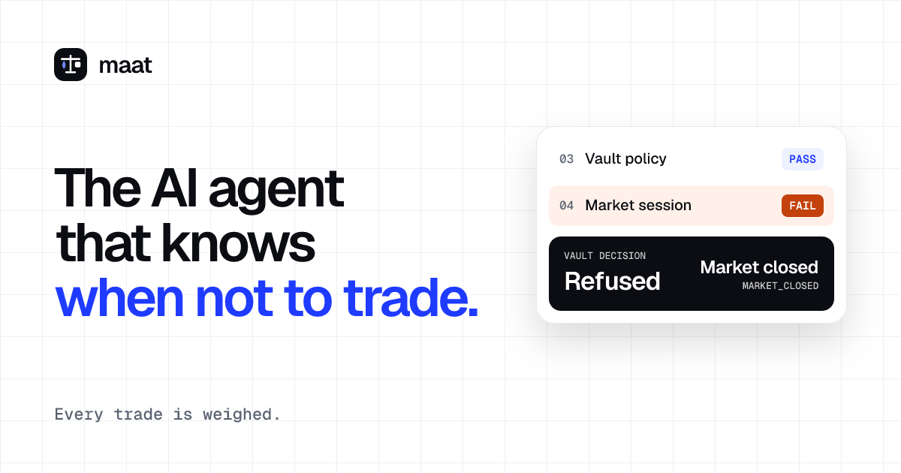
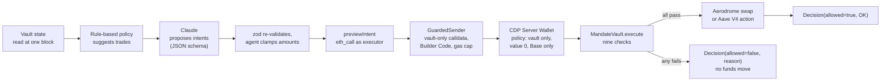

<div align="center">



# Maat

**An AI treasury agent for tokenized stocks on Base. Claude proposes every trade; an onchain vault decides. The vault refuses to trade when the US market is closed, the price feed is stale, the pool has drifted from the oracle, or a stock split is pending. A refusal does not revert: the vault emits a typed `Decision` event and moves no money.**

[](#status)
[](#base-mainnet-fork-evidence)
[](#built-for-stocks-maxxing-season)
[-15803d?style=flat-square)](#development)
[](LICENSE)

**[Evaluate in 5 minutes](#how-to-evaluate-maat-in-5-minutes)** · **[What is built](#status)** · **[The nine checks](#the-nine-checks)** · **[Safety](#safety-architecture)** · **[Fork evidence](#base-mainnet-fork-evidence)** · **[Limitations](#known-limitations)** · **[Design spec](docs/superpowers/specs/2026-11-06-mandate-treasury-design.md)** · **[Website](https://maatonbase.xyz)** · **[@maatonbase](https://x.com/maatonbase)**

<sub>Built for Base "Stocks Maxxing Season" (Agentic Stock Finance) · Solidity 0.8.28 on Base (Foundry, <code>hardfork = "base:Cobalt"</code>) · B20 stocks · Chainlink equity feeds · Aerodrome Slipstream · Aave V4 · Coinbase CDP Server Wallet · ERC-8021 Builder Codes · Claude</sub>

</div>

Tokenized stocks on Base trade 24 hours a day, 7 days a week. The stocks they track do not. When NYSE is
closed, the Chainlink equity feed stops updating and the DEX price has nothing to anchor it; when a company
splits its shares or pays a dividend, the B20 token's multiplier changes and every valuation shifts. An AI
agent that trades by itself will happily buy at a Saturday price nobody can check.

Maat puts the rules where the agent cannot talk its way around them. The agent's owner deploys a
`MandateVault` with a mandate: which stocks, how much per trade and per day, the maximum gap between pool
and oracle, the trading session, and the health factor for borrowing. Claude reads the vault's state and
proposes trades. The agent can only send them through `execute`, and `execute` runs nine market and mandate
checks in a fixed order, behind a pause switch and a balance check. If any check fails, the vault does not
revert: it emits `Decision(allowed=false, reason)` and moves no money, so every refused `execute` call leaves
a public, typed record. If the executor key leaks, the attacker gets exactly the same nine checks.

> The LLM proposes. The contract decides.

> [!IMPORTANT]
> **Unaudited, and not on Base mainnet yet.** The contracts, the agent runtime and the website are built
> and tested, including on a local fork of Base mainnet. No Maat contract has been deployed to Base
> mainnet at this commit, so there is no live vault address or mainnet transaction to show yet; the owner
> signs the deploy by hand ([`deployments/README.md`](deployments/README.md)). The site is being
> deployed at [maatonbase.xyz](https://maatonbase.xyz). x402 revenue, the Guard Service API, MCP, the
> Bankr Skill and `MandateFactory` are **planned, not built**. See [Status](#status).

## Contents

- [How to evaluate Maat in 5 minutes](#how-to-evaluate-maat-in-5-minutes)
- [Status](#status)
- [The problem](#the-problem)
- [Why it is different](#why-it-is-different)
- [What Maat does](#what-maat-does)
- [How a decision is made](#how-a-decision-is-made)
- [The nine checks](#the-nine-checks)
- [Safety architecture](#safety-architecture)
- [Base mainnet fork evidence](#base-mainnet-fork-evidence)
- [Base integrations](#base-integrations)
- [The default mandate](#the-default-mandate)
- [The agent runtime](#the-agent-runtime)
- [The website](#the-website)
- [Where things are in this repository](#where-things-are-in-this-repository)
- [Development](#development)
- [Deploying (owner only)](#deploying-owner-only)
- [Known limitations](#known-limitations)
- [Roadmap](#roadmap)
- [Documentation](#documentation)
- [Built for Stocks Maxxing Season](#built-for-stocks-maxxing-season)
- [License](#license)

## How to evaluate Maat in 5 minutes

You need `git`, [Foundry](https://getfoundry.sh) 1.8.4 or newer (for the `hardfork = "base:Cobalt"`
setting in `foundry.toml`, which the B20 stock precompiles need; 1.9.0 was used here), Node.js 24 with npm,
and a bash shell (Linux, macOS, or Git Bash on Windows). No wallet, no RPC URL, no API key: every step below runs offline against mocks and fakes.

On a fresh clone this path took about 4 minutes on a Windows 10 machine (Foundry 1.9.0, Node 24.12): most
of it is compiling the contracts (about 1.5 minutes over steps 2 and 3) and two `npm ci` runs (about a
minute each).

1. **Clone.** Only the two direct submodules are needed (forge-std and v4-core); `--recursive` is not.

   ```bash
   git clone https://github.com/duongnq2798/maat.git
   cd maat
   git submodule update --init
   ```

2. **Watch the vault refuse a Saturday buy without reverting.** This unit test sets the clock to
   Saturday 2026-10-31 18:00 UTC and asks the vault to buy $20 of a mock B20 stock. The first run
   compiles the contracts.

   ```bash
   cd contracts
   forge test --match-test test_refusalIsLoggedNotReverted -vvvv
   ```

   Expected output (trimmed: `…` marks removed lines and shortened hashes; gas figures can differ by
   Foundry version):

   ```text
   [PASS] test_refusalIsLoggedNotReverted() (gas: 198082)
   …
       ├─ [109794] MandateVault::execute(Intent({ id: 0xb10e…, action: 0, token: 0x2e23…, amount: 20000000 [2e7], minOut: 0, … }))
       │   ├─ [4640] MockB20::uiMultiplier() [staticcall]
       │   │   └─ ← [Return] 1000000000000000000 [1e18]
       │   ├─ [2838] MockB20::isPaused(0) [staticcall]
       │   │   └─ ← [Return] false
       │   ├─ [2843] MockB20::policyId(0xb817…) [staticcall]
       │   │   └─ ← [Return] 0
   …
       │   ├─ [8133] MarketCalendar::isOpen(1793469600 [1.793e9], 0) [staticcall]
       │   │   └─ ← [Return] false
       │   ├─ emit Decision(intentId: 0xb10e…, action: 0, token: MockB20: [0x2e23…], amount: 20000000 [2e7], allowed: false, reason: 6, rationaleHash: 0x6254…)
       │   └─ ← [Return] false, 6
       ├─ [2486] MockERC20::balanceOf(MandateVault: [0x15cF…]) [staticcall]
       │   └─ ← [Return] 200000000 [2e8]
       ├─ [3051] MandateVault::usedIntent(0xb10e…) [staticcall]
       │   └─ ← [Return] true
   ```

   After snapshotting the token's multiplier, the vault checks that the token is in the mandate (check 1, a
   storage read that the trace does not show), reads its pause flag (check 2) and its four transfer-policy
   legs (check 3), then asks the calendar, which says closed (check 4). `reason: 6` is `MARKET_CLOSED` in
   [`Types.sol`](contracts/src/Types.sol). `execute` returned normally, the vault still holds its 200 USDC,
   and the intent id is spent, so the same request cannot be replayed.

3. **Run every contract unit test** (vault, guards, calendar, price math, both adapters):

   ```bash
   forge test --no-match-path "test/fork/*"
   ```

   ```text
   Ran 8 test suites in …: 220 tests passed, 0 failed, 0 skipped (220 total tests)
   ```

4. **Run the agent's tests.** Claude, the Coinbase CDP wallet and the chain are all fakes here, so nothing
   is sent and nothing is billed.

   ```bash
   cd ../agent
   npm ci
   npm test
   ```

   ```text
    Test Files  24 passed (24)
         Tests  167 passed (167)
   ```

5. **Run the website's tests and build it.** `facts.test.ts` reads the Solidity sources and the committed
   fork-run gas log, so a number on the page that drifts from the code fails here.

   ```bash
   cd ../web
   npm ci
   npm test
   NEXT_TELEMETRY_DISABLED=1 npm run build
   npm run check:out
   ```

   ```text
    Test Files  14 passed (14)
         Tests  124 passed (124)
   ...
   out/ is ready to deploy
   ```

   `npm run dev` then serves the page on http://localhost:3000. Its hero is the decision engine: toggle
   between Thursday 5 Nov, 10:30 ET (allowed) and Saturday 7 Nov (refused, `MARKET_CLOSED`).

**Optional, needs a Base archive RPC:** the 14 contract fork tests run the real B20 tokens, feeds, pools and
Aave V4 at two pinned mainnet blocks. Nothing is broadcast; Foundry forks the chain locally.

```bash
cd contracts   # from the repository root
export BASE_RPC_URL=<a Base mainnet archive RPC URL>
forge test --match-path "test/fork/*"
```

```text
Ran 7 test suites in …: 14 tests passed, 0 failed, 0 skipped (14 total tests)
```

That took about 50 seconds here, at this commit.

## Status

What exists at this commit, and what does not.

| Component | Status | Where |
| --- | --- | --- |
| `MandateVault`: holds USDC and B20 stocks, runs the nine checks, logs every verdict as `Decision`, 24 h timelock on every rule change | **Built and tested** (220 unit tests across the contracts, 14 fork tests). **Not deployed** on mainnet | [`contracts/src/MandateVault.sol`](contracts/src/MandateVault.sol) |
| `GuardLib`: market-safety checks (pause, transfer policy, session, feed, multiplier, premium) | **Built and tested** | [`contracts/src/GuardLib.sol`](contracts/src/GuardLib.sol) |
| `MarketCalendar`: NYSE session in America/New_York, DST computed onchain, holidays and early closes | **Built and tested**. Preloaded with 3 holidays and 2 early closes up to 2027-01-01 | [`contracts/src/MarketCalendar.sol`](contracts/src/MarketCalendar.sol) |
| `AerodromeSwapAdapter`: exact-input swaps directly against Aerodrome Slipstream pools | **Built**, unit and fork tested | [`contracts/src/adapters/AerodromeSwapAdapter.sol`](contracts/src/adapters/AerodromeSwapAdapter.sol) |
| `AaveV4CreditAdapter`: supply B20 collateral, borrow and repay USDC on the Aave V4 MAG7 Spoke | **Built**, unit and fork tested (full supply, borrow, repay, withdraw loop) | [`contracts/src/adapters/AaveV4CreditAdapter.sol`](contracts/src/adapters/AaveV4CreditAdapter.sol) |
| Deploy script and Base mainnet configuration | **Built**; simulated on a fork (`test_deployWiresEverything`). The dry-run command against live mainnet state is in [`deployments/README.md`](deployments/README.md). The owner has not broadcast it yet | [`contracts/script`](contracts/script) |
| Agent runtime: vault reader, rule-based policy, Claude proposer, preview, guarded sender, journal, pending-tx reconcile | **Built and tested** (167 unit tests, 3 fork integration tests). The Claude proposer is tested against a fake client and the fork run uses a scripted proposer; no output from the real Claude API is committed yet | [`agent/`](agent) |
| ERC-8021 Builder Code on every agent transaction | **Built and tested** (unit tests and the fork run). No real code registered yet | [`agent/src/exec/builderCode.ts`](agent/src/exec/builderCode.ts) |
| Coinbase CDP Server Wallet as the executor, with an account policy | **Built**, tested against a fake CDP client only. Never run against real CDP | [`agent/src/exec/cdpSender.ts`](agent/src/exec/cdpSender.ts), [`agent/src/exec/cdpPolicy.ts`](agent/src/exec/cdpPolicy.ts) |
| Landing page with the interactive decision engine and the labeled fork ledger | **Built and tested** (124 unit tests, 7 Playwright tests). Static export. Being deployed at [maatonbase.xyz](https://maatonbase.xyz) | [`web/`](web) |
| Live mainnet ledger, dashboard and Base App mini-app manifest (W2), daily diary and replay page (W3) | **Planned** | [web spec §10](docs/superpowers/specs/2026-11-07-maat-web-design.md) |
| x402 revenue: other agents pay about one cent per "is this trade safe now?" check | **Planned**. Not implemented anywhere in this repository | [spec §3.4](docs/superpowers/specs/2026-11-06-mandate-treasury-design.md) |
| Guard Service HTTP API, MCP server, Bankr Skill | **Planned** | [spec §3.4](docs/superpowers/specs/2026-11-06-mandate-treasury-design.md) |
| `MandateFactory`: any agent deploys its own vault | **Planned** (stretch goal) | [spec §3.7](docs/superpowers/specs/2026-11-06-mandate-treasury-design.md) |
| Third-party audit | **None**. Treat the contracts as unaudited | |

## The problem

Each hazard below is something the vault checks for, with the reason code it returns.

| Hazard | What goes wrong for an agent that trades 24/7 | Reason code |
| --- | --- | --- |
| **The market is closed** | NYSE trades 09:30 to 16:00 ET on weekdays. The Chainlink equity feeds on Base update only from Sunday 20:00 ET to Friday 20:00 ET. On a Saturday or a holiday the DEX price has no live reference | `MARKET_CLOSED` |
| **The oracle is stale or broken** | A feed that stopped updating, or returns zero or a negative answer, cannot value anything | `FEED_STALE`, `BAD_PRICE` |
| **The pool has drifted from the oracle** | A thin CL pool can trade far from the feed. The vault compares a 30-minute TWAP with the oracle; in session on 2026-11-05 the gap measured 29 to 53 bps for the three basket stocks | `PREMIUM_TOO_HIGH` |
| **A corporate action is under way** | A split or dividend changes the B20 `uiMultiplier`. Values computed across the change are wrong, so the vault waits out a cooldown after any change, and refuses while a change is scheduled | `MULTIPLIER_COOLDOWN` |
| **The issuer paused the token, or its transfer policy blocks the path** | B20 tokens can pause transfers and enforce sender, receiver and executor policies. A swap that would fail mid-way should be refused up front | `TOKEN_PAUSED`, `POLICY_BLOCKED` |
| **The agent is simply wrong** | It proposes too much, too often, or all in one stock | `SIZE_LIMIT`, `CONCENTRATION` |

Spending caps on an agent wallet stop the last row. They do not know whether NYSE is open, whether the feed
is alive or whether a split is pending. Maat checks all of these, onchain, on every trade.

## Why it is different

- **The market calendar is onchain.** `MarketCalendar` computes the NYSE session in America/New_York, with
  daylight saving time, holidays and early closes. The vault never trusts the agent's clock or an offchain
  API to say whether the market is open.
- **It reads the B20 corporate-action surface.** The vault snapshots each token's `uiMultiplier`, watches
  `effectiveAt` for a scheduled change, and refuses to trade through the cooldown. These guards exist
  because Base's tokenized stocks expose these fields.
- **Refusals are data.** Each intent ends in a typed `Decision` event carrying `keccak256` of Claude's
  rationale. A refused trade leaves a public record instead of a revert that leaves none.
- **Credit that knows about weekends.** Stocks back USDC loans on Aave V4, but borrowing needs an open
  market, and the health-factor floor rises in the hours before the feeds stop for a weekend or holiday.
- **The agent is untrusted by design.** The same checks bind Claude, the agent's own code and anyone who
  steals the executor key.

## What Maat does

Maat is one agent with one vault: "Agent #1", owned by the team, trading only its own treasury of $20 to
$200. It runs a loop meant to pay for itself:

1. **Earn.** USDC that arrives in the vault is recorded as `RevenueReceived`. (The planned source is x402
   fees for safety checks; that part is not built yet.)
2. **Buy.** Keep an equal-weight basket of NVDAc, GOOGLc and AAPLc with 30% held in USDC, and rebalance when
   a weight drifts more than 5 percentage points.
3. **Supply.** Put idle stock on Aave V4 as collateral.
4. **Borrow.** Borrow USDC against it when cash falls below seven days of compute cost, only while the market
   is open and the projected health factor stays at or above 1.5 (2.0 in the de-risk window before a weekend
   or a market holiday, when the feeds are about to stop).
5. **Pay.** Track its own Claude spend and pay it in USDC with `PAY_EXPENSE` to an allowlisted payee, the
   wallet that pays for its Claude usage (for Agent #1, the owner's). This works at any hour. Repay debt when
   revenue arrives.

Every step is an `Intent` that goes through `execute`. The owner can pause the vault, swap the executor key
and withdraw funds at any time, and can change the rules only through a 24-hour timelock.

## How a decision is made



The agent-side steps are there to save gas and to keep a readable journal. None of them is trusted: the
vault re-runs every check itself, and a stolen executor key faces exactly the same rules.

A Claude proposal is a JSON object that must match a schema (at most 6 intents, each with an action, a
stock, a dollar amount and a rationale of at most 600 characters). The agent keeps the rationale text in its
journal and puts `keccak256(rationale)` onchain as `rationaleHash`, so each `Decision` can be matched to the
reasoning behind it. Claude's schema cannot express `PAY_EXPENSE`; the bill payment is added by code.

## The nine checks

`BUY` and `SELL` go through these checks in this order. The first failure decides the reason.
Code: [`MandateVault._check`](contracts/src/MandateVault.sol#L257-L282) and
[`GuardLib.checkMarket`](contracts/src/GuardLib.sol#L44-L62).

| # | Check | Refusal | Where | A test that shows it |
| --- | --- | --- | --- | --- |
| – | Vault not paused (every action except `REPAY`) | `VAULT_PAUSED` | [`MandateVault.sol#L259`](contracts/src/MandateVault.sol#L259) | `test_vaultPaused` |
| 1 | Token is in the mandate. `BUY` needs an allowed token; `SELL` also works for exit-only tokens, so a delisted stock can still be sold | `TOKEN_NOT_ALLOWED` | [`MandateVault.sol#L266`](contracts/src/MandateVault.sol#L266) | `test_exitOnlyTokenCanBeSoldNotBought` |
| 2 | Token transfers are not paused; a reverting read counts as paused | `TOKEN_PAUSED` | [`GuardLib.tokenPaused`](contracts/src/GuardLib.sol#L65) | `test_refusesPausedToken` |
| 3 | Every leg of the transfer passes the B20 policy registry (sender, receiver, executor, including `tx.origin`) | `POLICY_BLOCKED` | [`GuardLib.transferPathAuthorized`](contracts/src/GuardLib.sol#L145) | `test_refusesWhenPolicyBlocksVault` |
| 4 | Market open for the mandate's session (`REGULAR`: NYSE 09:30 to 16:00 ET with holidays and early closes) | `MARKET_CLOSED` | [`GuardLib.marketOpen`](contracts/src/GuardLib.sol#L74), [`MarketCalendar.isOpen`](contracts/src/MarketCalendar.sol#L63) | `test_refusalIsLoggedNotReverted`, `test_thanksgivingIsMarketClosedAtVaultLevel` |
| 5 | Oracle answer is positive and not older than `maxStaleness` | `FEED_STALE`, `BAD_PRICE` | [`PriceLib.readFeed`](contracts/src/lib/PriceLib.sol), [`GuardLib.sol#L50-L52`](contracts/src/GuardLib.sol#L50-L52) | `test_refusesStaleFeed` |
| 6 | No multiplier change: unchanged since the last snapshot, outside the cooldown, nothing scheduled | `MULTIPLIER_COOLDOWN` | [`GuardLib.multiplierBlocked`](contracts/src/GuardLib.sol#L118) | `test_multiplierChangeStartsCooldown`, `test_pendingMultiplierBlocks` |
| 7 | Pool TWAP is within `maxPremiumBps` of the oracle | `PREMIUM_TOO_HIGH`, `BAD_PRICE` | [`PriceLib.premiumBps`](contracts/src/lib/PriceLib.sol), [`GuardLib.sol#L58-L60`](contracts/src/GuardLib.sol#L58-L60) | `test_refusesPremium` |
| – | Amount is non-zero and covered by the balance. Market reasons take precedence | `INSUFFICIENT_BALANCE` | [`MandateVault.sol#L271-L274`](contracts/src/MandateVault.sol#L271-L274) | `test_marketReasonTakesPrecedenceOverBalance` |
| 8 | Notional within the per-trade cap and the UTC-day cap | `SIZE_LIMIT` | [`MandateVault._withinCaps`](contracts/src/MandateVault.sol#L500) | `test_perTradeCap`, `test_dailyCap` |
| 9 | `BUY` only: the stock's weight after the buy stays within `maxWeightBps`, measured on equity net of Aave debt; unreadable positions fail closed | `CONCENTRATION` | [`MandateVault._weightAfterBuyBps`](contracts/src/MandateVault.sol#L512) | `test_concentration`, `test_concentrationNetsCreditDebt` |

After the checks pass, the vault swaps with a slippage floor it computes itself from the oracle price and
`maxSlippageBps`, whatever `minOut` the agent sent (the agent always sends 0:
`test_slippageFloorIsEnforcedEvenIfAgentSendsZero`). A failed swap or token transfer is recorded as
`SWAP_FAILED` or `TRANSFER_FAILED`, and `execute` still does not revert.

**Other actions.** `PAY_EXPENSE` checks the payee allowlist, the balance and the shared daily cap, and works
when the market is closed. `SUPPLY` checks the token, pause and policy path. `BORROW` needs an open market,
healthy collateral (checks 2, 5 and 6 on every supplied stock) and a projected health factor of at least
`minHealthFactor`, or `targetHealthFactor` inside the de-risk window, the hours before 20:00 ET on a Friday
or on a weekday before a market holiday (`HEALTH_FACTOR_LOW`, `DERISK_WINDOW`). `REPAY` is allowed at any hour, even while the vault is paused.
Withdrawing collateral with no debt outstanding is allowed at any hour, but not while the vault is paused.
Code:
[`_checkExpense`](contracts/src/MandateVault.sol#L284) and
[`_checkCredit`](contracts/src/MandateVault.sol#L295).

**All refusal reasons** (`enum Reason` in [`Types.sol`](contracts/src/Types.sol), append-only):

| Group | Reasons (id) |
| --- | --- |
| Vault and routing | `VAULT_PAUSED` (1), `ACTION_NOT_SUPPORTED` (2) |
| Token | `TOKEN_NOT_ALLOWED` (3), `TOKEN_PAUSED` (4), `POLICY_BLOCKED` (5) |
| Market | `MARKET_CLOSED` (6), `FEED_STALE` (7), `BAD_PRICE` (8), `MULTIPLIER_COOLDOWN` (9), `PREMIUM_TOO_HIGH` (10) |
| Size and funds | `SIZE_LIMIT` (11), `CONCENTRATION` (12), `PAYEE_NOT_ALLOWED` (13), `INSUFFICIENT_BALANCE` (14) |
| Execution and credit | `SWAP_FAILED` (15), `TRANSFER_FAILED` (16), `CREDIT_FAILED` (17), `HEALTH_FACTOR_LOW` (18), `DERISK_WINDOW` (19) |

`OK` is 0, so there are 19 typed refusals. The agent's copy of this enum is tested against `Types.sol`
([`agent/test/types.test.ts`](agent/test/types.test.ts)), and so is the website's.

## Safety architecture

| Layer | What it enforces | Where |
| --- | --- | --- |
| **The executor's only power is `execute`** | Every function that moves funds or changes a rule is owner-only, and the owner is immutable. `notifyRevenue` and `syncMultiplier` are open to anyone and only record state | [`MandateVault.sol`](contracts/src/MandateVault.sol), `test_executorCannotUseOwnerFunctions` |
| **Nine checks, in the contract** | Market safety, size and concentration on every trade; health factor on every borrow | [The nine checks](#the-nine-checks) |
| **Refuse, do not revert** | A refused intent emits `Decision` and moves nothing. By design only `NotExecutor` and `IntentAlreadyUsed` revert (plain ERC-20 `balanceOf` and `decimals` reads are assumed not to) | `test_refusalIsLoggedNotReverted` |
| **Single-use intents** | Each intent id executes once, refused or not | `test_replayReverts` |
| **Fail closed** | A reverting pause, policy, calendar, multiplier, feed or Aave read counts as unsafe | `test_reverting*FailsClosed` in [`GuardLib.t.sol`](contracts/test/GuardLib.t.sol), `test_unreadableCollateralFailsConcentrationClosed` |
| **Slippage floor from the oracle** | The vault, not the agent, sets the minimum output | `test_slippageFloorIsEnforcedEvenIfAgentSendsZero` |
| **24-hour timelock** | Mandate, token and payee changes are queued, then applied with the exact queued values from 24 hours after queueing until 7 days after that, or cancelled | `test_mandateChangeNeedsTimelock`, `test_appliedParamsMustMatchQueued`, `test_expiredChangeReverts` |
| **Owner escape hatches** | `setPaused` (instant; `REPAY` still works), `setExecutor` (instant key rotation), `withdraw` (only to the owner) | `test_repayIsAllowedWhileVaultPaused`, `test_rotatingExecutorRevokesOldOne`, `test_withdrawOnlyGoesToOwner` |
| **Calendar can only get stricter** | The calendar owner can add holidays and earlier closes, never remove them | `test_ownerCanOnlyMakeItStricter` |
| **Guarded sender** | The agent sends only `execute`, `syncMultiplier` or `notifyRevenue` to the vault address, with an explicit gas limit (at most 3,000,000) and the Builder Code suffix | [`agent/src/exec/sender.ts`](agent/src/exec/sender.ts), [`sender.test.ts`](agent/test/sender.test.ts) |
| **CDP account policy** | The executor wallet may only send zero-value transactions to the vault on Base; raw hash signing is rejected | [`agent/src/exec/cdpPolicy.ts`](agent/src/exec/cdpPolicy.ts), [`cdpPolicy.test.ts`](agent/test/cdpPolicy.test.ts) |
| **Exactly-once sends** | Every `execute` is stored as pending before it is sent; the next round reconciles it against `usedIntent` before doing anything else, so a lost receipt cannot pay a bill twice | [`agent/src/loop/runOnce.ts`](agent/src/loop/runOnce.ts), `runOnce.test.ts` "reconciles a send that threw after broadcast instead of sending again" |
| **Halt on surprise** | If the preview said OK but the vault refused, or a receipt has no `Decision`, the round stops | `runOnce.test.ts` "halts when the preview said OK but the vault refused" |
| **Rate limits** | `MAAT_MAX_TX_PER_DAY` (default 40). Safety refusals (market, policy, size, concentration, health factor) are logged onchain at most once per reason per UTC day; bookkeeping refusals such as `INSUFFICIENT_BALANCE` cost no gas | [`agent/src/refusals.ts`](agent/src/refusals.ts) |
| **One agent per data directory** | A lock file is taken before the store or the wallet is opened | [`agent/src/loop/lock.ts`](agent/src/loop/lock.ts) |

**If the executor key leaks.** Say an attacker controls the server that runs the agent:

| The attacker can | but cannot |
| --- | --- |
| Call `execute` with any intent | Skip any of the nine checks, trade outside the session or the stock list, or beat the $50 per-trade and $100 per-day caps |
| Make bad but allowed trades inside the mandate | Send funds anywhere: swaps go to the allowlisted pool, borrowed USDC and collateral come back to the vault, and `PAY_EXPENSE` pays only allowlisted payees |
| Borrow against the stocks | Push the projected health factor below 1.5 (2.0 in the de-risk window) |
| Stop the agent | Change the mandate, withdraw, unpause or keep the key: the owner pauses or rotates the executor instantly, from their own wallet |

The fork test `test_compromisedExecutorIsBounded`
([`MandateVaultFork.t.sol`](contracts/test/fork/MandateVaultFork.t.sol#L83)) tries this against real Base
state: the executor pays $100 to an attacker address (`PAYEE_NOT_ALLOWED`), buys $60 of NVDAc (`SIZE_LIMIT`) and calls
`withdraw` (reverts `NotOwner`); the vault keeps all 200 USDC. What is not covered is listed under
[Known limitations](#known-limitations).

## Base mainnet fork evidence

Everything here ran on a local fork of Base mainnet, not on mainnet itself. Nothing was broadcast.

**The agent, end to end.** [`agent/test/integration/agent.fork.test.ts`](agent/test/integration/agent.fork.test.ts)
deploys the contracts with the real deploy script on an anvil fork at block 53,551,627 (Thursday
2026-11-05, 10:30 ET, NVDA feed 14 seconds old), funds the vault, runs agent rounds with a scripted
proposer in place of Claude, and checks that every transaction carries the Builder Code and an explicit gas
limit, and that each preview matches the onchain `Decision`.

| Round | Intent | Decision | gasUsed |
| --- | --- | --- | --- |
| Thursday 10:30 ET | BUY $20 of NVDAc | allowed, `OK` | 758,192 |
| Thursday 10:30 ET | SUPPLY $15 of NVDAc to Aave V4 | allowed, `OK` | 286,707 |
| Thursday 10:30 ET | BORROW $5 USDC | allowed, `OK` | 484,173 |
| Clock moved 2 days ahead (Saturday) | BUY $10 of GOOGLc | **refused**, `MARKET_CLOSED`, logged onchain | 111,116 |

The gas figures are the committed output of that run
([`fork-gas.json`](agent/test/integration/fork-gas.json)); the website reads them from there and its tests
fail if they differ. BUY gas varied by under 1% between two runs (754,854 and 758,192); the other three
did not change. The Saturday row is the same fork with the clock moved forward, not a real Saturday block.

**The contracts, against real Base state.** 14 Foundry fork tests in
[`contracts/test/fork/`](contracts/test/fork) pin two mainnet blocks: `BLOCK_SESSION` 53,551,627 (Thursday
2026-11-05, in session) and `BLOCK_WEEKEND` 53,340,127 (Saturday 2026-10-31, NVDA feed last updated Friday
around 19:51 UTC).

| Test file | What it shows |
| --- | --- |
| `MandateVaultFork.t.sol` | Buys and sells NVDAc in session, buys the basket, refuses a real-weekend buy in both session modes, and bounds a compromised executor |
| `MandateVaultCreditFork.t.sol` | The credit loop in session; then, with the clock moved to Saturday, borrowing is refused while repay and withdraw still work |
| `AaveV4CreditAdapterFork.t.sol` | Full supply, borrow, repay and withdraw on the Aave V4 MAG7 Spoke; reserve ids match the chain; a borrow below the minimum health factor reverts |
| `AerodromeSwapAdapterFork.t.sol` | Buys and sells NVDAc directly against the Slipstream pool |
| `PriceLibFork.t.sol` | The live basket trades near the oracle price |
| `B20Smoke.t.sol` | Reads B20 state through the precompile and transfers NVDAc |
| `DeployFork.t.sol` | The deploy script wires every contract and address correctly |

The measured in-session premiums at `BLOCK_SESSION` (NVDAc 53 bps, GOOGLc 49 bps, AAPLc 29 bps) are why the
default `maxPremiumBps` is 100 rather than 50
([`MaatConfig.sol`](contracts/script/MaatConfig.sol)).

**How to reproduce.** Contract fork tests: see the end of the [5-minute guide](#how-to-evaluate-maat-in-5-minutes).
The agent fork run needs a Base archive RPC and `base-anvil` v1.5.1, because upstream Anvil 1.9 reverts on the
B20 `uiMultiplier()` call; it takes 3 to 5 minutes. Steps: [`agent/README.md`](agent/README.md#test).

## Base integrations

All addresses are Base mainnet, from [`contracts/script/BaseAddresses.sol`](contracts/script/BaseAddresses.sol)
(verified on 2026-11-06).

| Integration | How Maat uses it | Address |
| --- | --- | --- |
| **USDC** | Treasury and quote asset | [`0x8335…2913`](https://basescan.org/address/0x833589fCD6eDb6E08f4c7C32D4f71b54bdA02913) |
| **B20 stocks** | The basket: NVDAc, GOOGLc, AAPLc. The vault reads `isPaused`, `policyId`, `uiMultiplier` and `effectiveAt` | [NVDAc](https://basescan.org/address/0xb20000000000000000000078ee7ce2fE4908108C), [GOOGLc](https://basescan.org/address/0xb2000000000000000000002D0BA3164cc74f58B7), [AAPLc](https://basescan.org/address/0xb200000000000000000000C2e324d24d7eEcd1fb) |
| **B20 policy registry** | Transfer-path authorization (check 3) | [`0x8453…0002`](https://basescan.org/address/0x8453000000000000000000000000000000000002) |
| **Chainlink equity feeds** | Oracle price per raw token (multiplier already included), staleness | [NVDA](https://basescan.org/address/0x04689a41629776563E6822F76f2e57D148d28513), [GOOGL](https://basescan.org/address/0x5bF49E0ffA937CE2FfF033c739aD7C634c4D34F2), [AAPL](https://basescan.org/address/0x787f13dEa48Db0897CbCDD985de77809D837F988) |
| **Aerodrome Slipstream** | Swap venue and 30-minute TWAP; called directly, no router | [NVDAc/USDC](https://basescan.org/address/0xF668e21993f0ACd7ab00BB1cFbAeD0df28A3C8EC), [GOOGLc/USDC](https://basescan.org/address/0x16c70F04C3080a127486Cdf5a4C33c066bBF47C3), [AAPLc/USDC](https://basescan.org/address/0xF5FCB9CDAFcE67d50AfEf298F88E709d2B946BA6) |
| **Aave V4 (MAG7 Spoke, Equities Hub)** | Stocks as collateral, USDC borrowing; the adapter is the Aave user and only its vault can move the position | [Spoke](https://basescan.org/address/0x17905Db0e4A3514467539956c084180616AE7B8D), [Hub](https://basescan.org/address/0xa4d5947Eb727A052bae69C593FfC84247EC9864E) |
| **Coinbase CDP Server Wallet** | The executor key, with an account policy (vault only, value 0, Base only). Built, not yet run live | [`cdpSender.ts`](agent/src/exec/cdpSender.ts) |
| **ERC-8021 Builder Codes** | Appended by the agent to the calldata of every transaction it sends (via `ox/erc8021`). Owner-signed transactions (deploy, `fund`, `setExecutor`) do not carry it | [`builderCode.ts`](agent/src/exec/builderCode.ts) |
| **Claude** | `claude-sonnet-5-5` with structured output proposes the round's intents | [`agent/src/llm/proposer.ts`](agent/src/llm/proposer.ts) |

AMZNc is not in the basket: its pool held only about $34k of liquidity when the basket was chosen.

## The default mandate

The deploy script uses [`MaatConfig.defaultMandate`](contracts/script/MaatConfig.sol) with the `REGULAR`
session.

| Parameter | Value | Meaning |
| --- | --- | --- |
| `sessionMode` | `REGULAR` | NYSE 09:30 to 16:00 ET, holidays and early closes applied |
| `maxPremiumBps` | 100 | Pool TWAP may differ from the oracle by at most 1% |
| `twapWindow` | 1800 s | 30-minute TWAP |
| `maxSlippageBps` | 100 | Minimum swap output is 99% of the oracle-implied amount |
| `maxStaleness` | 3600 s | Oracle answers older than one hour are stale |
| `multiplierCooldown` | 1 day | Wait after a corporate-action multiplier change |
| `perTradeCapUsd` / `dailyCapUsd` | $50 / $100 | Per trade, and per UTC day across trades and bill payments |
| `maxWeightBps` (per stock) | 4000 | No stock above 40% of net equity after a buy |
| `minHealthFactor` / `targetHealthFactor` | 1.5 / 2.0 | Borrow floor, and the floor inside the de-risk window |
| `deriskWindow` | 8 hours | 12:00 to 20:00 ET on Fridays and on weekdays before a market holiday |

## The agent runtime

[`agent/`](agent) is a TypeScript service (Node 22.9 or newer, viem, zod). One round:

1. Read the vault, tokens, feeds and Aave position at one pinned block. If any required read fails, do
   nothing.
2. Reconcile any transaction left pending by an earlier round.
3. Send `syncMultiplier` for any stock whose multiplier changed.
4. Compute rule-based suggestions, then ask Claude for intents.
5. Pay the compute bill first if at least $0.10 is owed, then each proposal: build the intent, preview it
   as the executor, and send it only if it is allowed, or if it is a market refusal worth logging today.
6. Journal everything to `data/journal.jsonl`.

It runs every 15 minutes in session and every hour outside. `MAAT_MODE` defaults to `dry-run`, which reads
the chain and calls Claude but sends nothing. Live mode needs a registered Builder Code and CDP keys, and is
set up by the owner. Runbook, configuration and recovery steps: [`agent/README.md`](agent/README.md).

## The website

[`web/`](web) is a static Next.js 16 export with no wallet, no RPC calls, no analytics and no cookies
(`npm run check:out` fails if a third-party script appears in the built pages). The hero is the decision engine:
a BUY on Thursday 10:30 ET (NVDAc, allowed) next to a BUY on Saturday (GOOGLc, refused), with the check that
stops it. Every number on the page lives in [`web/content/facts.ts`](web/content/facts.ts) with its source.
[`web/test/facts.test.ts`](web/test/facts.test.ts) checks the ones that come from code (the contracts, the
agent's policy and the fork run) against that code; the rest, such as the planned x402 price, cite the
design spec. Values that will exist only after the mainnet deploy are shown as `[after deploy]`, never as made-up
hashes. Details: [`web/README.md`](web/README.md).

## Where things are in this repository

```text
contracts/                 Foundry project (Solidity 0.8.28, via-IR, hardfork base:Cobalt)
  src/
    MandateVault.sol       the vault: mandate, nine checks, Decision log, timelock, credit routing
    GuardLib.sol           market-safety checks, inlined into the vault
    MarketCalendar.sol     NYSE session, DST, holidays, early closes
    Types.sol              Action, Reason, SessionMode, Intent, Mandate, TokenConfig
    adapters/              AerodromeSwapAdapter, AaveV4CreditAdapter and their interfaces
    lib/                   PriceLib (feed, TWAP, premium), DateLib, TokenTransfer
    interfaces/            B20, Aave V4, Chainlink and pool interfaces
  script/                  Deploy.s.sol, MaatConfig.sol (default mandate), BaseAddresses.sol
  test/                    8 unit suites, mocks/, utils/ fixtures, fork/ (7 fork test files)
agent/                     TypeScript agent runtime
  src/chain/               vault state reader, previewIntent
  src/llm/                 Claude proposer, prompt, schema, pricing
  src/exec/                Builder Code, calldata and gas rules, GuardedSender, CDP sender and policy
  src/loop/                one round, scheduler, single-instance lock
  src/ledger/              state store and JSONL journal
  test/                    unit tests with fakes; integration/ runs the Base fork
  scripts/                 cdp-setup.ts (owner, once), gen-abis.ts, smoke-claude.ts (paid API)
web/                       Next.js landing page, brand assets, parity tests, Playwright e2e
deployments/               mainnet deploy runbook and the (empty) address table
docs/superpowers/          design specs and implementation plans
```

## Development

| Suite | Command (in its folder) | Tests | Needs |
| --- | --- | --- | --- |
| Contracts, unit | `forge test --no-match-path "test/fork/*"` | 220 | nothing |
| Contracts, fork | `forge test --match-path "test/fork/*"` | 14 | `BASE_RPC_URL` (archive) |
| Agent, unit | `npm test` | 167 | nothing |
| Agent, fork integration | `npm run test:integration` | 3 | archive RPC, `base-anvil` v1.5.1 |
| Web, unit, component and parity | `npm test` | 124 | nothing |
| Web, end to end | `npm run e2e` (after `npm run build`) | 7 | `npx playwright install chromium` |

Contract unit tests by suite: MandateVault 64, MandateVaultCredit 54, GuardLib 44, MandateVaultAdmin 23,
AaveV4CreditAdapter 15, MarketCalendar 9, PriceLib 7, AerodromeSwapAdapter 4.

Other useful commands: `forge build --sizes` (MandateVault is 22,755 bytes of runtime code, 1,821 under the
24,576-byte limit), `npm run typecheck` in `agent/` and `web/`, `npm run verify` in `web/` (typecheck, tests,
build and output checks), and `npm run gen:abi` in `agent/` after a contract change.

**Windows.** A `.gitattributes` keeps text files LF on checkout. Clone into a short path, or skip
`--recursive`: v4-core's nested submodules hit the Windows path-length limit and are not needed.

There is no CI in this repository yet; the counts above were measured locally at this commit.

## Deploying (owner only)

Every mainnet transaction is signed by the owner from their own wallet; no script in this repository holds
a key. [`deployments/README.md`](deployments/README.md) has the pre-broadcast checklist (the owner address is
immutable, so a typo is permanent), the `forge script` commands, a $20 smoke test that expects a weekend
`MARKET_CLOSED`, the credit smoke test, the unwind procedure, and the handover of the executor role to the
CDP Server Wallet. Deployed addresses will be recorded in that file.

## Known limitations

- **Unaudited.** No third party has reviewed the contracts.
- **Not on mainnet yet.** All execution evidence is from a local fork. The Base App mini-app, x402 revenue
  and the live dashboard do not exist yet.
- **The calendar must be maintained.** It ships with Thanksgiving 2026, Christmas 2026 and New Year 2027,
  plus early closes on 2026-11-27 and 2026-12-24. Later holidays need `addHoliday` from the calendar owner.
  If one is missed, the session check treats that day as a normal session, and only the feed-staleness check
  is left to stop a trade. `FEED_24_5` mode ignores early closes.
- **The feed is assumed to include the multiplier.** The vault treats each Chainlink equity answer as the
  price of one raw token with the B20 multiplier already applied. That matched Coinbase's NAV price when it
  was checked during development, with the multiplier close to 1
  ([Plan 1](docs/superpowers/plans/2026-11-06-maat-plan-1-core-contracts.md)); it has not yet been observed
  across a real split.
- **`tx.origin` in the policy check.** The B20 executor policy is checked against `tx.origin` (a read-only
  policy lookup, never for authentication). The executor must therefore be an account the token's policy
  allows, and `previewIntent` must be called with `from` set to the executor.
- **Preview cannot see everything.** `previewIntent` cannot predict `SWAP_FAILED`, `TRANSFER_FAILED`,
  `CREDIT_FAILED`, or Aave's health check after a collateral withdrawal against debt.
- **Caps are simple.** The daily cap is a UTC-day counter. Credit actions are bounded by the health factor,
  not by the trade caps. Bill payments share the daily cap with trades.
- **Gas estimation.** The vault catches inner failures, so `eth_estimateGas` can return a limit too low for
  the swap. The agent uses fixed floors (2,500,000 for `execute`) and a 3,000,000 cap instead.
- **Operational costs.** The executor needs a little ETH on Base for gas (the CDP paymaster serves smart
  accounts only). Dry-run mode still calls Claude, at roughly one cent per round.
- **The owner is a single key.** It is immutable and has no transfer function. A multisig owner is
  compatible but not set up.
- **Dependency advisories.** `npm audit` reports 3 high-severity advisories in the agent (zod 3 and abitype
  nested in `@coinbase/cdp-sdk`, no safe override yet) and 4 in the website's dev-only tools (2 moderate,
  2 high: `fflate` under `satori`, which renders the brand images, and `compression` under `serve`, which
  the e2e tests use). None of the website's flagged packages ships in the static site.

## Roadmap

Planned, roughly in this order. None of this is built.

1. Mainnet deploy of Agent #1's vault by the owner, executor handed to the CDP Server Wallet, the first real
   `Decision` events, the live ledger on the website and a Base App mini-app manifest (W2).
2. x402 Guard Service: other agents pay about one cent per check, and that USDC funds the treasury loop.
3. MCP server and Bankr Skill exposing the same check.
4. `MandateFactory`: any agent deploys its own vault with its own mandate.
5. Daily diary and replay page (W3).

## Documentation

| Document | What it covers |
| --- | --- |
| [Design spec](docs/superpowers/specs/2026-11-06-mandate-treasury-design.md) | Product, architecture, the checks, threat model, open assumptions |
| [Web design spec](docs/superpowers/specs/2026-11-07-maat-web-design.md) | Website goals, design tokens, page structure, parity tests, W2 and W3 |
| [Plan 1: core contracts](docs/superpowers/plans/2026-11-06-maat-plan-1-core-contracts.md) | Calendar, price library, guards, swap adapter, vault |
| [Plan 2A: credit](docs/superpowers/plans/2026-11-06-maat-plan-2a-credit.md) | Aave V4 adapter, credit actions, de-risk window |
| [Plan 2B: agent runtime](docs/superpowers/plans/2026-11-06-maat-plan-2b-agent-runtime.md) | Claude, CDP, Builder Code, reconcile |
| [Plan W1: website](docs/superpowers/plans/2026-11-07-maat-web-w1.md) | The landing page and brand assets |
| [`agent/README.md`](agent/README.md) | Running the agent, configuration, recovery |
| [`deployments/README.md`](deployments/README.md) | Mainnet deploy runbook |
| [`web/README.md`](web/README.md) | Website commands, numbers, deploy |

The specs record the design as approved and the plans record how the code was built; neither is updated
afterwards, and some details changed during implementation (for example the default `maxPremiumBps` rose
from 50 to 100, the de-risk window from 4 to 8 hours, and the spec's CDP spend cap became the vault's own caps
plus `MAAT_MAX_TX_PER_DAY`). Where a spec or plan differs from the code, the code is correct.

## Built for Stocks Maxxing Season

Maat is an entry in Base's "Stocks Maxxing Season" Builder Quest (5 November to 5 December 2026), track
Agentic Stock Finance. All code in this repository was written during the Quest: the first commit is
`ce1bbb4` on 2026-11-06.

How it was built: each part started as a design spec, then a written plan, then implementation task by task
with Claude Code, with a review after each task and a review of the whole branch at the end. The specs and
plans are in [`docs/superpowers`](docs/superpowers), and every commit carries a `Co-Authored-By: Claude`
trailer.

Maat holds only its own treasury. It gives no investment advice, confers no shareholder rights and is not
offered to US persons.

## License

Maat is released under the [MIT License](LICENSE). The Solidity sources carry the matching
`SPDX-License-Identifier: MIT` header.
